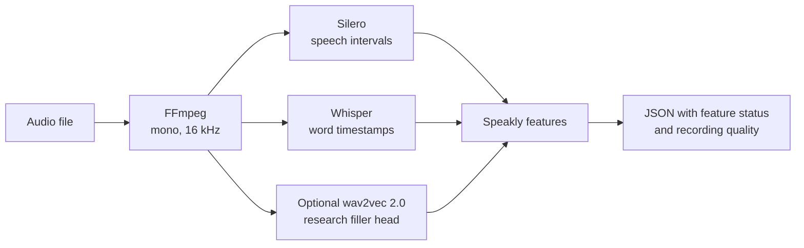

# English audio analysis and filler research

## Current status (2026-11-27)

The prototype has a Python audio/video CLI, multi-recording aggregation, a stateless roadmap API, training/evaluation code, and a private Kaggle notebook. The filler model trained on two Tesla T4s and its output is retrievable from Kaggle. This remains research work: general speaking-behavior accuracy is not established, the 80% target has not been shown across recordings, video observations lack labeled speaking-video evaluation, and the disfluency head is not a validated detector. The package's 15 audio fields and video measurements must not be described as 15 validated diagnoses or model capabilities. Read [Sherria Codex pickup](Sherria%20Codex%20pickup.md) for the current handoff and [onboarding roadmap plan](onboarding-roadmap-plan.md) for product scope.

### Earlier Kaggle review (2026-11-27)

This section describes an earlier pilot. Later runs and results are recorded below; do not treat its next steps as the latest status.

Three private Kaggle runs were inspected. The AMI adaptation run completed and produced metrics; the AMI verbatim pilot completed and produced metrics; a newer AMI audio-validation kernel reports `COMPLETE` but its downloaded notebook has no executed-cell outputs and its output contains only the notebook-conversion log, so its 24-setting decoder sweep is **not available and must not be treated as run evidence**. Its metadata confirms a T4 and internet were enabled. Another adaptation attempt, `notebookee544df586`, failed before training because `torch.cuda.is_available()` was false and the notebook raised “Enable a GPU accelerator in Kaggle.” Enable a Kaggle GPU before rerunning that notebook; no model code defect was identified from this failure.

The corrected validation kernel version 4 also failed at its initial GPU check. Kaggle metadata still says `enable_gpu: true` and `machine_shape: NvidiaTeslaT4`, but the runtime reported `torch.cuda.is_available() == false` and stopped before downloading data or scoring. No new metrics were produced. This points to an accelerator allocation/session issue rather than a detector result. In Kaggle, open the notebook settings, choose GPU, restart the session, and confirm `torch.cuda.get_device_name(0)` prints a T4 before rerunning. If GPU remains unavailable, check Kaggle accelerator quota/account status; do not interpret another immediate startup failure as a model failure.

The verbatim pilot uses CrisperWhisper small on two AMI development headset tracks (two speakers, about 2,289 seconds total). With the revised 0.50 target, only five of 35 report rows have labeled references; the other 30 are `missing_reference`, not failed model scores. All five measured rows are below target:

| Behavior | Metric | Result | Details |
| --- | --- | ---: | --- |
| Inter-segment pauses | Event F1 | 0.141 | 52/595 events matched to 144 references; 14.23 false alarms/minute |
| `um` | Event F1 | 0.000 | 0/52 events matched; only 10 references across both tracks (one track has no positive `um`) |
| `uh` | Event F1 | 0.280 | 45/378 matched; 69 references |
| Speaking rate | Within ±10 WPM | 0.000 | Mean absolute recording error 78 WPM |
| Rate changes by thirds | Within ±15 WPM | 0.000 | Mean absolute vector error 116.4 WPM |

Per-recording errors are uneven: speaking-rate error is 121.3 WPM on IS1008a.D and 34.7 WPM on TS3004a.A. The pilot skipped 28 and 43 zero-duration ASR words on the respective tracks and logged missing-attention-mask warnings. Those are investigation clues, not proof that they caused the rate errors. The pauses output currently includes every gap between Silero speech regions, while the AMI reference uses gaps between manually annotated speaker segments; this operational mismatch may contribute to the high false-alarm count. Do not tune to this reference until the event definition is reviewed and both reference and prediction semantics are confirmed.

The separate WavLM AMI adaptation run evaluated 79 filler references on the same two development recordings. Pooled event F1 was 0.291 for the original checkpoint at threshold .60 (P=.206, R=.494, 3.93 false alarms/min), versus .251 for the adapted head at .60 (P=.229, R=.278, 1.94 false alarms/min). At .80, original F1=.246 and adapted F1=.222. Adaptation did not improve pooled F1; it traded recall for fewer false alarms. Class-level results also conflict: adaptation modestly improved `um` F1 but reduced `uh` F1. The adaptation data and evaluation cover only two development speakers, so these are diagnostic pilot results, not a general accuracy claim.


The corrected version writes its metrics and run summary to top-level Kaggle output files, but it still needs one successful GPU run to retrieve them. After that, use the best weaker-class filler setting from the development sweep only as a candidate, then evaluate it on new speakers. Separately audit speaking-rate word alignment and pause definitions. Do not claim the 0.50 target is reached from the prior runs: none of the five scored behaviors reaches it, and the remaining 30 lack labels.

The `session.py` combiner preserves per-sample observations and missing evidence; it reports coverage, not agreement or weakness. Energy spread is relative within a recording and does not measure absolute vocal projection.

The session entrypoint now accepts a JSON manifest (`recordings`: a list of two or three objects with `id`, audio `path`, and optional `targets` list). Run `PYTHONPATH=backend python -m speech_analysis.session manifest.json --model tiny.en --cache-dir /path/to/cache`; relative audio paths resolve relative to the manifest. A failed recording is reported without discarding the others. A CPU smoke run using the existing JFK and AMI clips returned ten fields for both recordings without recorded model errors; this checks integration only, not evaluator accuracy. The CPU test suite passed 13 tests. Multi-sample output currently reports coverage only, not recurring/mixed behavior, and is not yet wired to the roadmap.

The in-progress session output now has 15 named fields: the previous ten and five experimental transcript observations (main point, supporting detail, transitions, closing and prompt relevance). The latter overlap conceptually with the prior phrase-based `organization` and `prompt_coverage` fields; they must not be counted as independent weaknesses. For the five new fields, `--content-openai` explicitly sends each transcript and its optional manifest `prompt` to the configured OpenAI model using `OPENAI_API_KEY` and `OPENAI_MODEL`; calls request `store: false`. Positive findings require an exact transcript quote. Without the flag, a key, or successful provider output, those fields are unavailable. `store: false` is a request setting, not a statement about all provider data retention. No live API test was possible because this environment has no OpenAI key. The default path was CPU-smoke-tested on two existing recordings and returned 15 fields, including five unavailable content observations. Eighteen tests pass. Fifteen output fields do **not** demonstrate 15 validated distinct capabilities; detector improvements, meaningful labeled evaluation and roadmap integration remain outstanding.

Filler training now supports `--unfreeze-last N` to compare the frozen-head baseline with partial encoder fine-tuning. The head uses AdamW at 0.001, selected encoder layers at 0.00001; these are experiment settings, not demonstrated optimal values. New checkpoints include fine-tuned encoder weights and remain compatible with older head-only checkpoints. One- and two-worker CPU smoke runs with three clips per split completed, and the single-worker checkpoint loaded in the audio CLI on the JFK fixture. These tiny runs verify wiring only. Twenty-two unit tests pass. No new Kaggle run has been launched; controlled model selection, held-out evaluation, and the rest of the evaluator remain outstanding.

The comparison workflow now trains frozen and partially unfrozen variants using train/validation splits only, chooses the higher validation mean filler F1 (ties favor the frozen model), and evaluates the selected checkpoint on the test split. A two-worker CPU fixture exercised both choices and a single-worker selected-checkpoint test; six examples per split are insufficient for performance conclusions. The official test split has already been used in the earlier baseline experiments documented below, so it is not an untouched final benchmark for this project. The Kaggle generator now encodes this comparison but has not yet run it remotely. Twenty-three unit tests pass.

`handoff.roadmap_evidence(profile, session)` prepares a versioned roadmap input and excludes names, raw age, transcripts, audio, and content excerpts. Free-form profile values and caller-supplied sample IDs can themselves contain identifying information, so callers must choose these appropriately. `roadmap.py` now implements a stateless FastAPI endpoint and a server-side OpenAI Responses API call with schema-constrained output; mock-provider tests cover the contract. The live provider call still needs a securely configured key and smoke test. Returned observations do not automatically become weakness judgments.

DisfluencySpeech's annotated transcript uses bracketed reparandum/repair pairs such as `[ I, + I ]`; `disfluency.labeled_repairs` now extracts those pairs and applies a conservative text-prefix rule to distinguish repetition from other repairs. In a read-only inspection of the first 100 training rows, 45 had at least one parsable pair (25 repetition events, 36 other repairs). These counts are parser output, not manually verified labels or model performance. Single-speaker acted audio and markup gaps make this dataset insufficient to validate generalization, and unmarked repairs must not be treated as certain negatives. No disfluency model has been trained. Twenty-eight CPU unit tests pass.

The transcript heuristic now detects immediately repeated phrases of up to four words in addition to single words, taking the longest match at each location. On the first 100 DisfluencySpeech training transcripts, comparing whether any repetition was found against automatically parsed bracket labels yielded 23 true positives, 3 false positives, 0 false negatives and 74 true negatives. This is a row-level development sanity check on reference transcripts, not audio inference, a held-out test, or a human-verified benchmark; it can overestimate real performance. Deliberate repetition remains indistinguishable from disfluency. Twenty-nine CPU unit tests pass.

The filler training code now also supports pinned `microsoft/wavlm-base-plus` revision `4c66d4806a428f2e922ccfa1a962776e232d487b` as a frozen encoder candidate, motivated by the [WavLM paper](https://arxiv.org/abs/2110.13900). Checkpoints record their encoder family, while legacy head-only checkpoints default to wav2vec2; loading a mismatched encoder fails. One- and two-worker CPU smoke runs completed with six clips per split and the resulting WavLM checkpoint ran through the JFK audio CLI without model errors. Those tiny runs do not establish comparative accuracy. The Kaggle job includes the third candidate, but has not yet run it. Thirty CPU unit tests pass. Model and dataset usage rights must be reviewed for the intended use; the existing PodcastFillers-derived models remain research-only.

An experimental `train_disfluency` command now trains a two-output frozen wav2vec2/WavLM head for clip-level presence of parsed repetition and repair annotations. It reads DisfluencySpeech parquet, filters out audio longer than 12 seconds to avoid truncating clip-level labels, resamples to 16 kHz, masks padded frames when pooling, and evaluates against a separate validation file. No bracket annotation means no *parsed annotation*, not proof no disfluency occurred. A two-worker CPU smoke run used distinct sets of six rows drawn from the dataset's test parquet solely for wiring; validation F1 was zero for both labels and this tiny fixture cannot measure performance. No usable disfluency model, event timing, inference integration, full dataset training, or independent-speaker validation has yet been established. Thirty-five CPU tests pass.

The optional `--disfluency-head` CLI argument now returns uncalibrated probabilities for twelve-second recording segments under `research.disfluency_segments`; these are not event timestamps and are excluded from the roadmap handoff. The CPU fixture checkpoint ran through the audio CLI, and a separate held-out-evaluation command ran on six additional fixture clips. A three-recording session smoke test used two real clips and a deliberately missing third file: the two usable results survived, the missing file was reported, and a 13-field roadmap evidence contract was produced. The full transcript-based OpenAI path remains untested live because no API key is configured. Thirty-nine CPU unit tests pass.

Private [Kaggle notebook version 2](https://www.kaggle.com/code/shouryakaveti/speakly-filler-research) was submitted and is queued. The code requests two T4 GPUs, compares three filler candidates using validation selection, and trains the experimental disfluency head against the pinned DisfluencySpeech parquet files with SHA-256 checks. No GPU allocation, completion, or results have been confirmed yet. Version 2 supersedes the earlier statements in this file that a new Kaggle run has not been launched.

The OpenAI request construction has also been checked with a mocked HTTP provider: it uses structured output, requests `store: false`, and keeps the API key out of the request body. This does not verify a live provider call or provider retention policy. Forty CPU tests pass.

## Kaggle version 2 results and next decisions

Version 2 completed. Run metadata and training outputs report two Tesla T4 GPUs; they do not measure GPU utilization. The filler candidates were selected by mean validation F1 for “um” and “uh” on 2,379 isolated clips: frozen wav2vec2 0.748, partially unfrozen wav2vec2 0.757, frozen WavLM 0.895. The selected WavLM model scored F1 0.925 for “um” and 0.823 for “uh” on 9,475 official test clips (mean 0.874). The test has been used in earlier experiments and is not pristine. The selected-model comparison is erroneously labeled `wav2vec2_head` in the test JSON; checkpoint metadata and `selected.json` show it is WavLM. Isolated clip classification does not establish event-detection performance in full onboarding recordings. PodcastFillers annotations restrict derived models to noncommercial research.

The disfluency head performed poorly on 250 held-out single-speaker acted clips: repetition 0 true positives and 73 false negatives; repair 2 true positives, 1 false positive and 59 false negatives (recall 3.3%, F1 0.063). Its zero predicted repetitions make precision undefined, even though the metrics code reports zero. It should not be used for coaching decisions. Parsed bracket labels and the single speaker limit what these results establish. Diagnose class imbalance, thresholds and clip-level pooling against validation data before another training run; compare event-aware approaches and independently sourced speakers before claiming generalization. Do not tune against the test set.

Selected WavLM checkpoint SHA-256: `427945fc6f3c614d4d7a35faa5ec4c51ccfaaeb66fc38a7a3086806c43147c12` (local research copy under `/workspace/scratch/speakly-v2-selected/filler-comparison/wavlm/`). Disfluency checkpoint SHA-256: `0f03044d6239ea77d6a6bc6fdcefb750df29dd8054d65121c0599b69de49d1c1`. They remain research artifacts, not validated coaching models. Raw metrics were downloaded under `/workspace/scratch/speakly-v2-json/`.

The combined session contract omits overlapping legacy `organization` and `prompt_coverage` heuristics and exposes audio measurements plus experimental transcript observations. A fifteen-field output is not evidence of fifteen validated independent capabilities. Transcript observations require the optional OpenAI call and are unavailable by default. Their live provider operation and accuracy have not been verified. The roadmap endpoint is implemented separately in `roadmap.py`.

Speakly measures one recording at a time. A caller can compare the two onboarding responses using the same schema. Each result describes its own recording. The roadmap service can use reviewed observations alongside the user's goal. Recording analysis and the two OpenAI onboarding questions serve separate roles.



| Observation | Method and limit |
|---|---|
| Speaking rate | Recognized words per minute of full response. Quiet time is included. |
| Rate changes | Three equal time windows. Each needs at least four recognized words. |
| Pauses | Gaps between Silero speech intervals. Default detector padding affects boundaries. |
| Fillers | Timestamped transcript tokens `um` and `uh`, or experimental wav2vec 2.0 window predictions. Whisper can omit fillers. |
| Repetitions | Adjacent identical recognized words, excluding `um` and `uh`. Deliberate repetition can match. |
| Revisions and false starts | Explicit repair phrases or interruption punctuation preserved by transcription. These are clues with incomplete coverage. |
| Prompt coverage | Exact phrase checks against the prompt author's supplied targets. Paraphrases can be missed. |
| Organization | Indicators for explicit point, example, and closing phrases. A false indicator means the marker was absent, and structured answers can omit these phrases. |
| Pitch variation | pYIN 90th-to-10th percentile span in semitones over voiced frames. It describes the sample and carries no normative rating. |

Quality checks include decoded duration, detected speech duration, clipping and model errors. Speech below one second or severe clipping suppresses feature values. Noise and transcription quality require further evaluation. Experimental fields need validation on Speakly prompts before they drive roadmap selection. Clinical and personal trait assessment falls outside the audio contract.

## Run locally

From the repository root on Linux or macOS with Python 3.12 and FFmpeg:

```bash
python -m venv backend/.venv
source backend/.venv/bin/activate
# Use the PyTorch CPU index on Linux. On macOS use ordinary pip for torch and torchaudio.
pip install --index-url https://download.pytorch.org/whl/cpu torch torchaudio
pip install -r backend/speech_analysis/requirements.txt
PYTHONPATH=backend python -m speech_analysis response.wav --target "example phrase"
PYTHONPATH=backend python -m unittest discover -s backend/speech_analysis/tests
```

The first run downloads model weights. `--cache-dir` selects a writable model cache. `--model tiny.en` selects a faster smoke-test model. The default is `small.en`. The CLI accepts audio decodable by FFmpeg up to 240 seconds. It emits JSON on stdout and returns nonzero for unreadable input or a core audio-stage failure. Load an optional research checkpoint with `--filler-head path/to/filler-head.pt`.

For a human reference, use a JSON object keyed by feature name. For `pauses` use a list of `start_s` and `end_s` records. For `fillers` include lowercase `text` as well. The evaluator uses a 250 ms tolerance for both boundaries and matches each reference at most once.

```bash
PYTHONPATH=backend python -m speech_analysis.evaluate observation.json reference.json
```

## Models and data

| Source | Use in this prototype |
|---|---|
| [Whisper](https://github.com/openai/whisper) | Official MIT implementation and `small.en` weights. Native timestamping keeps one transcription pass. |
| [Silero VAD](https://github.com/snakers4/silero-vad) | Pretrained speech interval model, reused through its Python package. |
| [librosa pYIN](https://librosa.org/doc/main/generated/librosa.pyin.html) | Pitch estimation. |
| [wav2vec 2.0 base](https://huggingface.co/facebook/wav2vec2-base) | Frozen audio encoder pinned to revision `0b5b8e868dd84f03fd87d01f9c4ff0f080fecfe8`. Speakly trains a linear three-class head over pooled encoder frames. |
| [PodcastFillers](https://zenodo.org/records/7121457) | Official one-second clips and CSV for training and held-out evaluation. The official split separates podcast shows. The verified CSV contains 64,835 train, 2,379 validation, and 9,475 test events in the consolidated split. |
| [DisfluencySpeech](https://huggingface.co/datasets/amaai-lab/DisfluencySpeech), [AMI](https://huggingface.co/datasets/edinburghcstr/ami), [LibriSpeech](https://huggingface.co/datasets/openslr/librispeech_asr) | Candidates for subsequent reference-based transcription and timing checks. These were not used to train the filler head. None supplies Speakly's own prompt rubric labels. |

The code integrates upstream packages and checkpoints directly. Keeping upstream code as a dependency avoids maintaining forks. PodcastFillers' annotation terms limit this training experiment to noncommercial research. Keep its data and derived checkpoint in the private research workspace. [Annotation terms](https://podcastfillers.github.io/license/)

## Kaggle experiment

The private notebook is generated by `backend/speech_analysis/kaggle_job.py`. It checks for two T4 GPUs, downloads the official final ZIP volume and annotations, verifies their published checksums, and extracts numbered clips with a verified 7-Zip binary. The ZIP central directory places all 85,803 numbered clips on the final volume, so the generator supplies sparse offset placeholders for the earlier episode volumes and verifies the extracted filenames against the CSV. This reduces the download from about 25.3 GB to 5.9 GB. Distributed data parallelism runs two training workers. The saved checkpoint is selected by validation macro F1 across the two filler classes. The output includes a held-out test confusion matrix and a paired comparison with Whisper transcript counting on a fixed subset of up to 32 held-out clips per class. Isolated event-clip scores do not establish detection accuracy on full responses. Evaluate event timing and false alarms on consented onboarding recordings before using the classifier for recommendations.

```bash
python backend/speech_analysis/kaggle_job.py KAGGLE_USERNAME /path/to/private-kernel-bundle
kaggle kernels push --path /path/to/private-kernel-bundle --accelerator NvidiaTeslaT4
```

The API credential is supplied through the environment. The notebook stores its artifacts under `/kaggle/working/filler-results`.


## Verified CPU results

- Four unit tests cover the feature contract, silence, transcription failure, and event matching.
- The [Whisper JFK fixture](https://github.com/openai/whisper/blob/main/tests/jfk.flac) produced a valid nine-field result with the default `small.en` model. On this cloud executor, an 11-second clip took 11.92 seconds and about 1.85 GB peak RSS with weights already cached. Initial download took substantially longer. This is a single run, not a latency benchmark.
- A two-second silent clip returned nine insufficient-evidence results. A `tiny.en` run on the same speech fixture loaded the optional filler head and executed window inference. That head was trained on synthetic tones for wiring checks.
- Single-process CPU and two-process CPU training ran through the dataset loader, train and validation loops, checkpoint save and reload, and test reporting. Synthetic fixture scores have no meaning for filler accuracy.
- A split ZIP fixture verified that the selected extractor reproduces the original clip byte-for-byte. Zenodo's CSV checksum matched and no episode ID appeared in multiple official clip splits.

Kaggle accepted the private [Speakly Filler Research notebook](https://www.kaggle.com/code/shouryakaveti/speakly-filler-research) as version 1. Reading back its metadata confirmed `NvidiaTeslaT4`, and the running notebook reported two Tesla T4 GPUs. Version 1 uses the full split archive. The smaller staging path in the local generator passed a split-archive fixture and has yet to run on Kaggle.

Two samples from the LibriSpeech clean test split (`6930-75918-0000` and `6930-75918-0001`) had one word edit across 51 reference words in total with `small.en`. Both came from the same reader and are only transcription sanity checks. They do not establish word error rate for spontaneous onboarding speech.

A CPU smoke run used 18 official PodcastFillers clips (six per split). It loaded the official labels, wrote and reloaded a checkpoint, and compared both models on the same six held-out clips. The WAV payload CRCs matched the archive directory. The tiny sample is a wiring check, with no claim about filler performance.

A CPU fixture with two synthesized speech sections separated by two seconds of inserted silence produced a 2.276-second estimated gap. The speech boundaries extend beyond the inserted silence itself. The fixture also exercised prompt coverage and the example marker.

The optimized staging method extracted 18 byte-identical clips from the real ZIP64 layout using its central directory and verified byte ranges. The full optimized download and Kaggle run remain unverified.

Three short samples from the AMI headset test split produced 7 word edits across 32 reference words with `small.en`. The sample is too small to estimate domain performance. It illustrates why the clean LibriSpeech check cannot stand in for conversational or onboarding speech.


## Completed training run

Private Kaggle version 1 completed three epochs on two Tesla T4 GPUs. The training script reported 211.53 seconds through checkpoint selection, excluding data staging and the final comparisons. Epoch 3 had the highest mean validation F1 across “um” and “uh” (0.748). The encoder stayed frozen and the three-class linear head was trained.

| Evaluation | Clips | “Um” F1 | “Uh” F1 | Mean filler F1 |
|---|---:|---:|---:|---:|
| wav2vec 2.0 head, official test split | 9,475 | 0.806 | 0.690 | 0.748 |
| wav2vec 2.0 head, matched subset | 96 | 0.813 | 0.702 | 0.757 |
| Whisper transcript count, same subset | 96 | 0.755 | 0.171 | 0.463 |

On the full test split, precision and recall were 0.850 and 0.766 for “um,” and 0.741 and 0.645 for “uh.” The paired comparison used 32 clips per class. It shows that the audio head recovered more fillers in that sample, with a precision tradeoff. The evaluation uses centered, one-second podcast clips, whereas onboarding inference scans whole recordings. Event-level precision, recall, and timing on those recordings still require annotations. Keep the head optional for research.

The private run's `filler-results/` output contains `metrics.json` and `filler-head.pt`. The downloaded head's SHA-256 is `4ab282e8724e7aa3ce8fe9306007fe375c2dafc31566f6b67c89da314f022fbd`. [Kaggle run](https://www.kaggle.com/code/shouryakaveti/speakly-filler-research)

The downloaded Kaggle checkpoint also loaded in the CPU analyzer. It returned all nine feature fields with no model errors on the 11-second JFK fixture. The run took 18.79 seconds with weights cached and reported no filler events on that clip. This verifies integration of the trained weights, with no estimate of detection accuracy on full recordings.

## Onboarding video prototype

The optional video stage uses [MediaPipe Pose Landmarker Lite](https://ai.google.dev/edge/mediapipe/solutions/vision/pose_landmarker). Install `backend/speech_analysis/requirements-video.txt` and download the [version 1 model bundle](https://storage.googleapis.com/mediapipe-models/pose_landmarker/pose_landmarker_lite/float16/1/pose_landmarker_lite.task), SHA-256 `59929e1d1ee95287735ddd833b19cf4ac46d29bc7afddbbf6753c459690d574a`.

Set `"video": true` for a video recording in the session manifest and run `PYTHONPATH=backend python -m speech_analysis.session manifest.json --pose-model pose_landmarker_lite.task`. Audio-only recordings can be in the same manifest. Video adds ten measurements to the fifteen existing fields. These cover shoulder tilt, lateral lean, horizontal and vertical torso movement, head orientation proxy and movement, each wrist's movement, hand movement asymmetry, and wrist spacing. Most quantities use shoulder width as the scale. Results depend on camera angle, camera stability, visibility, and the framing. The head orientation proxy is not an eye contact measure. Missing or obscured landmarks suppress the affected measurements. Results remain experimental in the roadmap handoff.

A three-second CPU fixture made from MediaPipe's sample pose image with a speech audio track detected pose in all fifteen sampled frames. The same MP4 and a separate audio clip completed a mixed session with 25 evidence fields. Controlled landmarks exercise translation and occlusion. The image fixture checks detection and plumbing only. Motion accuracy and coaching relevance require recordings with varied framing and reference annotations before a pilot can establish performance. The Kaggle repetition/repair checkpoint remains research-only and is excluded from the roadmap handoff.

Two additional CPU integration fixtures ran through FFmpeg and MediaPipe. A controlled horizontal translation of the pose image detected a pose in 15 of 15 frames, with median horizontal movement 0.1686 shoulder widths per sampled frame and vertical movement 0.0006. A blank clip detected no poses in 15 frames and returned insufficient evidence for all ten video fields. These fixtures confirm directional response and abstention. The translation can also represent camera motion, so the evaluator cannot attribute it to the speaker without a stable camera. Real speaker movement accuracy remains unmeasured.

## Onboarding integration and evaluation status

Install `backend/speech_analysis/requirements-roadmap.txt` and run `PYTHONPATH=backend uvicorn speech_analysis.roadmap:app`. POST to `/api/roadmap/generate` with `confirmed: true`, a nonempty `goal`, optional `profile`, and two or three `samples` in the existing combiner format (`id`, `result.features`, optional `result.quality`). The response includes evidence, recording quality, ten outline weeks, and seven catalog activities of ten minutes each. The service uses only descriptive timing estimates in the model input. It returns 503 without `OPENAI_API_KEY`; `OPENAI_MODEL` optionally selects the model. The mock provider exercises the same route and output validation.

The video report now has 15 fields. Five new fields describe the fraction of usable frames or transitions with rapid wrist movement (2 shoulder widths per second), wrists close together (0.25 shoulder widths), a wrist near the nose (0.35 shoulder widths), visible wrists, and pose coverage. These are provisional pose-based proxies. Wrist proximity cannot establish contact, rubbing, or the reason for movement. Pose coverage and wrist visibility describe recording quality. The thresholds have no behavior-level validation yet.

| Source | Labels and population | Use and split |
|---|---|---|
| PodcastFillers | Timestamped filler events in English podcasts | Noncommercial research under annotation terms. Prior official clip test is historical. A fresh full-recording test is pending. |
| DisfluencySpeech | Parsed repetition and repair annotations from one actor | Development only. Separate corpus is needed for speaker-held-out evaluation. |
| MediaPipe sample image derivatives | Known translation, static pose, and empty frame fixtures | Engineering checks only. No annotated real speaker movements. |
| Speakly reference recordings | Proposed timestamped events and visibility conditions | Pending. Use consented recordings, separate speakers by split, and freeze thresholds before the test. |

`recording_event_metrics` computes micro precision, recall, F1, false alarms per minute, and matched boundary error on full-recording predictions and references. There is no new population accuracy estimate. The video system still requires hand and face tracking, camera motion checks, and temporal event labels to cover the approved gesture and habit definitions. No new Kaggle experiments were submitted in this integration pass.

### Detailed landmark and camera-motion checks

The video and session CLIs accept optional `--hand-model` and `--face-model` arguments. Use the version 1 MediaPipe Hand Landmarker and Face Landmarker bundles. With both enabled, hand-near-face uses fingertip-to-nose image distance scaled by eye spacing. It reports timestamped intervals after three consecutive positive samples at 5 Hz. Tracking gaps end intervals, and proximity alone cannot establish physical contact or a habit. The session records diagnostic coverage under `research.video_landmarks`.

The camera check estimates global translation from optical flow outside the previous pose bounds. Motion or inadequate reliable background tracks suppress camera-relative torso sway and vertical motion. Rotation, zoom, moving backgrounds and camera-motion thresholds still need labeled evaluation. Controlled image translation and textureless backgrounds exercise the estimator. On MediaPipe sample-image fixtures encoded as short clips, the portrait detected face and hands in 10 of 10 frames, and a thumb fixture detected a hand and no face in all 10 frames. These checks verify tracker wiring and visibility, not repeated-habit accuracy.

### Continuous audio benchmark

Run `python -m speech_analysis.evaluate_podcast AUDIO CSV EPISODE CHECKPOINT` with `PYTHONPATH=backend`. It scores a continuous excerpt (default 60–240 seconds of the original episode) using Silero and the existing WavLM inference threshold of 0.85, without tuning. A match requires the same label and both boundaries within 250 ms. This is a strict check because the current detector outputs approximate one-second windows. PodcastFillers annotations come from candidate events, so apparent false alarms should be audited for unannotated genuine fillers before interpreting precision. Use the official split and preserve episode grouping.

The existing transcript rules were also scored on all 250 supplied reference transcripts in the official DisfluencySpeech test parquet. Comparing utterance-level presence with the bracket parser, repetition was 73 true positives, 10 false positives and zero false negatives (F1 0.936). Repair was 3 true positives, 16 false positives and 58 false negatives (F1 0.075). This is a transcript-only baseline from one actor. It bypasses speech recognition, does not score timing, and does not establish performance on incoming audio.

Two CRC-verified original episode files supplied the first continuous benchmark. Both used 180 seconds starting at 60 seconds with the published checkpoint and threshold unchanged. No threshold was selected from the test result.

| Official episode split | References / predictions | Center P / R / F1 (250 ms) | Boundary F1 (250 ms) | Unmatched predictions/min (center) |
|---|---:|---:|---:|---:|
| Validation, Grrrl, Uninterrupted | 12 / 20 | .450 / .750 / .563 | .125 | 3.67 |
| Test, The Genealogy Happy Hour | 13 / 8 | .875 / .538 / .667 | .095 | .33 |

Center-matched timing error averaged 96 ms on validation and 87 ms on test. The center metric evaluates event localization separately from the boundary mismatch caused by one-second windows. One episode per split and candidate-based annotations limit the results. Treat the test episode as a historical baseline for subsequent variants. Neither score meets the 85–90% target.

For the staged accuracy goal, keep camera-motion checks, visibility checks, and repeated behaviors separate in the benchmark. A visible quick gesture is an observation, while recurrence needs multiple annotated intervals and adequate visibility between them. Reference videos should include stationary and moving cameras, deliberate gestures and similar-looking non-events, and obscured hands and faces. Use speaker-disjoint validation and test groups. Report event F1 and precision/recall for repeated habits, measurement error for continuous motion, and the fraction of usable recordings each result covers.

The benchmark accepts repeated `--threshold` arguments and reuses one WavLM inference pass. The validation excerpt gave midpoint F1 .370, .408, .488, .563 and .636 at .40, .55, .70, .85 and .95 respectively. At .95 precision was .700 and recall .583. The test excerpt was not used to choose thresholds or rerun at these thresholds. The default remains .85 because a single episode does not support calibration. Tests verify that multiple thresholds can use the same candidate windows.

A CPU audio-to-transcript smoke benchmark ran Whisper `small.en` with word timestamps and the existing transcript rules on the first 32 official DisfluencySpeech test rows. For utterance-level bracket presence, repetitions yielded 1 TP / 2 FP / 4 FN (F1 .25); repairs yielded 0 TP / 3 FP / 8 FN (F1 0). This uses one acted speaker, a small deterministic prefix, and full-utterance speech intervals to isolate ASR plus transcript rules. It confirms the reference-transcript score does not transfer to the current audio path. A disfluency-preserving, time-aligned baseline and speaker-disjoint labels are needed for further model selection.

### Research-backed candidate ablation

Silero covered the midpoints of all 12 validation and 13 test annotations at its existing settings. Ignoring um/uh identity improved validation midpoint F1 from .563 to .625 and left test midpoint F1 at .667. Thus the observed gap includes classifier and proposal errors beyond class confusion or VAD coverage. One-second proposal boundaries also inflate timing error.

The experimental `--transcript-candidates --cache-dir CACHE` path in `evaluate_podcast` follows the [PodcastFillers paper's ASR/VAD candidate method](https://arxiv.org/html/2203.15135). It centers one-second classifier inputs on detected-speech gaps in Whisper timestamps and keeps explicit transcript fillers. Candidate intervals give tighter boundaries. At threshold .85 on the same 180-second validation excerpt, midpoint F1 dropped from .563 to .353 (3 of 12 matched, 5 emitted), and boundary F1 rose from .125 to .235. A validation-only union with the original .85 or .95 proposals, excluding duplicates within 350 ms, did not beat the equivalent baseline. A fixed-width diagnostic shrinking the original proposals to .35 seconds raised validation boundary F1 to .563 at .85 and .636 at .95. This diagnoses window geometry but does not recover missed detections or establish actual boundaries. None of the experimental settings changed the default evaluator or was selected on the test excerpt.

Next training should use time-aligned frame labels and offset jitter as in the paper's frame-classifier approach, including ordinary speech as hard negatives. Score midpoint and boundary F1 separately on more untouched continuous recordings, and use speaker-disjoint spontaneous speech with time-aligned annotations for repetition and repair. No public dataset in the current workspace supplies labels for all proposed video behaviors.

### Frame-level timing experiment

`speech_analysis.train_filler_frames` uses PodcastFillers' official clip split and event boundaries to supervise 20 ms WavLM frames. It trains a linear head on frozen WavLM features, shifts training events by up to 120 ms, and uses labeled non-filler clips as negatives. Continuous evaluation with `evaluate_podcast --frame-head` averages overlapping windows and reports midpoint and boundary F1. The original clip evaluator rejects frame checkpoints to prevent silently applying the wrong inference method.

One- and two-worker CPU smoke runs verified training and checkpoint export on the existing 18-clip fixture. The one-worker checkpoint emitted zero events at thresholds .50–.70 on the continuous validation excerpt. This is a wiring check with six training clips, not a meaningful performance estimate. The private Kaggle frame experiment was submitted separately with two T4s requested. Configuration: official PodcastFillers train and validation splits, 3 epochs, 32 clips per worker, WAV archive and annotation checksums verified by the notebook, WavLM pinned as above. It remains research-only under the PodcastFillers annotation terms. Final GPU allocation and model performance remain pending.

The private frame run completed on two Tesla T4s. Validation mean F1 for the two filler classes improved across epochs from .763 to .781 to .790 on annotated clip frames. This metric scores 20 ms frames, whereas continuous evaluation matches whole events. Checkpoint SHA-256: `d669cda8a31b6fe023dba3b645d751f5f3ecf4eadfb884e5695f074434ca6bf9`.

Continuous validation of the trained frame head used the same 180-second validation excerpt and a threshold sweep from .50 to .95. Threshold .90 maximized midpoint F1 (.600, 6 matches out of 8 predictions and 12 references); boundary F1 was .500. The strongest sliding-window validation threshold (.95) had midpoint F1 .636 and original-window boundary F1 .182. Freeze .90 for frames and .95 for the tuned baseline before scoring the newly extracted Pat Finn test excerpt. The .85 default baseline is reported for continuity.

Both configured models were scored on the same previously unused continuous test excerpt, `CEO Interview 2017_Pat Finn`, 60–240 s (18 “um”, 18 “uh”). The episode was recovered from the original split archive and matched its CRC32. Thresholds were frozen before evaluation.

| Model | Midpoint P / R / F1 | Boundary F1 | Midpoint false alarms/min | Mean matched midpoint error |
|---|---:|---:|---:|---:|
| Default sliding windows, .85 | .611 / .306 / .407 | .000 | 2.33 | 170 ms |
| Tuned sliding windows, .95 | .733 / .306 / .431 | .000 | 1.33 | 170 ms |
| Frame model, .90 | .846 / .306 / .449 | .367 | .67 | 64 ms |

Frame predictions matched 11 of 36 references by midpoint, the same count as both baselines. Silero covered 36 of 36 reference midpoints and collapsing the labels to a single filler class did not change the frame model's midpoint result. Prioritize recall through validation-only error analysis and training on longer contiguous, time-aligned speech, with a temporal head and examples of both missed fillers and confusing ordinary speech. Keep the current detector default unchanged. Use multiple validation episodes to tune duration and confidence and reserve new test recordings. This one excerpt supplies a paired comparison, not a population estimate. Raw results are in `/workspace/scratch/speakly-episode-bench/fresh-frame.json` and `fresh-baseline.json`.

### Validation-only decoder comparison

Compared both CRC-verified validation episodes at 60–240 s, adding `LMScast_315 How to Create Profitable Online Courses and Membership Sites Even After Failures Along the Way` to the prior Grrrl excerpt. The two excerpts contain 15 labeled filler events across six minutes. The same cached WavLM frame scores were reused for all configurations.

| Frame decoder | Boundary P / R / F1 | Midpoint P / R / F1 | Unmatched midpoint predictions/min |
| --- | --- | --- | --- |
| Existing comparison setting (.90, 5 frames) | .600 / .400 / .480 | .700 / .467 / .560 | .50 |
| Best fixed threshold (.80, 8 frames) | .636 / .467 / .538 | .727 / .533 / .615 | .50 |
| Best hysteresis (.85 onset, .75 continuation, 8 frames, 0 gap frames) | .583 / .467 / .519 | .667 / .533 / .593 | .67 |

Swept 12 fixed settings and 108 hysteresis settings. The best fixed setting recovered one additional correctly localized filler. The best hysteresis setting used zero gap frames and added one more unmatched prediction than the best fixed threshold. Results are too sparse to change defaults. The held-out excerpt was excluded from this sweep. Preserve fresh episodes for final evaluation and test training/inference context matching next: use longer contiguous windows, retain verified positive events, and audit high-scoring ordinary speech before using it as hard negatives. The training clip pipeline uses one-second crops and a frozen WavLM encoder; this run isolates decoding and provides no evidence for a new training recipe yet.

### Continuous training data audit

The pinned PodcastFillers CSV contains 28,793 filler events across 173 official training episodes and 1,148 across six validation episodes. There are 36,042 marked training examples of words, breaths, laughter, or music. The official train and validation clip rows agree with their source episode splits. The 9,114 `extra` rows have no consolidated event label and span all three episode splits.

For four-second windows centered on each marked filler, the union of official marked intervals covers an average of 14.1% of training time and 14.0% of validation time. This measures annotation coverage. The rest of each window has unknown status under these labels. For a clean longer-context comparison, use labels for marked filler and marked non-filler frames, mask ambiguous and unmarked frames during training, and audit high-scoring unmarked validation spans before interpreting them as false alarms. Either keep the baseline at one second or explicitly configure the longer window at both training and inference. The current inference path scores overlapping one-second windows, and the current Kaggle setup retrieves numbered clips only. Continuous training requires retrieving original training episode audio separately. Group windows by source episode before sampling and preserve the held-out test recordings.

### Four-second training path

`speech_analysis.train_filler_frames --episodes EPISODE_WAV_DIRECTORY --csv LABELS --output CHECKPOINT` reads four-second windows from mono 16 kHz episode WAV files named after the CSV's `podcast_filename` column. Frame targets use explicitly marked events. Unmarked frames and overlapping frames with conflicting labels are excluded from loss and metrics. The checkpoint records window size, and `evaluate_podcast --frame-head` reuses that size for scoring, including the one-second fallback for historical checkpoints.

The 56-test CPU suite passed. A separate CPU smoke run trained frozen WavLM on two synthetic six-second WAVs, exported a four-second checkpoint, and loaded it through the recording evaluator. Synthetic fixtures verify wiring only. A meaningful run still needs the original training and validation episodes prepared as WAVs, plus an event-level comparison on continuous validation recordings.

The original archive directory matched all 173 training and six validation filenames in the official episode split. The training MP3 payloads occupy about 7.00 GB compressed across `.z03` (107 recordings) and `.zip` (66). Validation occupies about 0.29 GB in `.zip`. All 20 test episodes are on `.z03` and can be excluded by selecting only train/validation archive members. The clip-only sparse placeholders cannot supply original episode audio. For a full training run, stage the needed members from their actual volumes and check archive CRCs before decoding.

A real-data CPU smoke run used a CRC-verified a16z training episode and separate Grrrl and LMScast validation episode files. With one epoch and up to 24 windows per split, validation filler-class mean frame F1 was .463. The exported checkpoint produced no detections at .80 on the Grrrl 60–240 s excerpt (12 annotated references). This confirms original-episode ingest, training, and checkpoint evaluation. It provides no evidence of a gain at this training size. The .80 threshold was previously selected for the one-second model, so it is only a wiring check here. The full training experiment needs its own validation threshold and a reserved test set.

Generate the private continuous experiment with `python -m speech_analysis.kaggle_job --continuous KAGGLE_OWNER OUTPUT_DIRECTORY` from a shell with `PYTHONPATH=backend`. The notebook downloads and verifies the official final ZIP, third split volume, and CSV before extracting only the 179 train/validation recordings. 7-Zip verifies member CRCs during extraction. The other two volumes are sparse offset placeholders. Extraction is followed by 16 kHz mono decoding and distributed training with 8 windows per worker, 3 epochs, and two T4s. The notebook saves `filler-continuous-head.pt`. A local 7-Zip fixture verified train/validation selection, exclusion of the test member, and WAV conversion. All archive member paths match the official directory. Notebook generation was verified locally; the full Kaggle run has not been submitted.

Kaggle accepted version 1 of the private [Speakly Filler Continuous notebook](https://www.kaggle.com/code/shouryakaveti/speakly-filler-continuous) as a Quick Save with GPU T4 ×2 requested. The upload response reported no execution. The immediate status query returned RUNNING, so actual cell execution was unconfirmed.

The failed Kaggle log showed repeated DNS failures resolving `pypi.org` during dependency installation. The job never entered dataset staging or training and produced no checkpoint or accuracy metrics. Version 4 was uploaded as a Quick Save with internet enabled in metadata. It checks DNS for PyPI, Zenodo, and Hugging Face before package installation and installs only the two explicit frame-training dependencies. The generated cell compiled locally. Kaggle connectivity still needs confirmation during the next run.

The subsequent run again failed on Kaggle DNS for PyPI before training. The downloaded remote metadata showed internet enabled. Version 6 was saved without execution. It retries required DNS lookups, skips installing dependencies already present at their required versions, and retries dataset downloads on connection errors. Local checks compiled the generated notebook and simulated transient and persistent DNS failures. Persistent Kaggle network outages still prevent access to the original dataset and pinned model.

The next Kaggle run failed all four DNS lookups for Zenodo and stopped before training. Version 8 adds an offline input path. Attach a private bundle containing a `speakly-continuous-input.json` marker, the original `PodcastFillers.zip`, `PodcastFillers.z03`, and `PodcastFillers.csv`, the pinned 7-Zip 25.01 Linux binary as `7zz`, the pinned Hugging Face WavLM snapshot in `wavlm/`, and any missing runtime wheels in `wheels/`. The offline path verifies archive and executable checksums and uses local-only model and wheel loading. The full bundle has not been staged or attached. The emitted notebook compiled and a mocked attached input skipped DNS, and all 56 local tests passed. No training was launched when uploading version 8.

### Completed four-second Kaggle run

Kaggle completed three epochs on two Tesla T4s. Validation filler-class mean frame F1 was .866, .867, and .875. The final metric appeared about 2 h 22 min after notebook start. Checkpoint SHA-256: `68aee44b596e7a36c46f5c1aaa083b4dfb0c46aa1cd4540872cc211484f19ca4`. The frame metric covers marked intervals only and is not directly comparable with continuous event F1.

On the same two 180-second validation excerpts used for the one-second decoder, the four-second model at .75 found 12 of 15 labeled events by midpoint but produced 39 unmatched predictions. A threshold-only sweep achieved .519 midpoint and boundary F1 at .95. Requiring 12 consecutive frames at .80 improved both metrics to .621 (9 matches, 14 predictions, 15 references, .83 unmatched predictions/min). A two-model agreement filter peaked at .593 on these excerpts. The earlier one-second model's best validation setting gave .615 midpoint and .538 boundary F1. The four-second model recovers one more matched midpoint with two more unmatched predictions. The validation excerpts are small and contain candidate annotations rather than exhaustive labels. Keep deployment defaults unchanged.

Both checkpoints were then evaluated on the CRC-verified, previously unused official test episode `Claire Zorn_'Turns Out I Had More Things To Write Down!'`, 60–240 s, with 19 marked events. Settings were frozen using the two validation excerpts.

| Checkpoint and decoder | Midpoint P / R / F1 | Boundary F1 | Unmatched midpoint predictions/min |
| --- | --- | --- | --- |
| One-second, .80 and 8 frames | 1.000 / .789 / .882 | .765 | 0.00 |
| Four-second, .95 and 5 frames (best threshold-only validation setting) | .933 / .737 / .824 | .765 | .33 |
| Four-second, .80 and 12 frames (best duration-calibrated validation setting) | .696 / .842 / .762 | .667 | 2.33 |

The four-second settings improve one aspect at a time. The duration-calibrated setting catches one more filler than the one-second comparison and adds seven unmatched events. The one-second model exceeded .80 midpoint F1 on this excerpt, but previously scored .449 on the Pat Finn excerpt under a different decoder setting. The new score is not a repeatable milestone across recording conditions. Do not select a decoder from this held-out comparison. Build an exhaustively reviewed, multi-episode validation set and inspect unmatched detections before treating them as hard negatives or running another long GPU experiment. The evaluator now accepts `--min-frames` to reproduce threshold-plus-duration tests. Local suite: 56 passing tests.

All five unmatched midpoint predictions from the four-second duration-calibrated validation run were centered outside every interval in the official CSV, including marked non-filler intervals. They are unreviewed, so they should not be used as hard negatives yet. A local listening queue in `/workspace/scratch/speakly-episode-bench/validation-listening/review.csv` pairs two-second audio clips with timestamps for those five predictions and the six missed references.

Whisper small.en CPU transcribed all 11 two-second validation review clips with word timestamps. It emitted neither “um” nor “uh” in any clip, including the six clips with official filler labels. Ordinary words spanned the candidate midpoint in all five unmatched clips, and Whisper also aligned ordinary words across or near the center of the labeled misses. The short-clip transcript is therefore a poor adjudicator for these examples. The review labels remain blank, and these clips were not added as training negatives. If all five unmatched events were genuine additional fillers, the two-excerpt midpoint F1 would change from .621 to .824 with the six existing misses still counted. This is a sensitivity calculation, not measured performance.

The fingertip proximity observation now reports observed returns separately from intervals. Two proximity intervals count as a return only when separated by at least three consecutive frames with both landmarks visible and the fingertip away from the face. Occlusion can split an interval but cannot establish separation. The focused video suite passed five tests, including visible separation, tracking loss, and intermittent visibility. The observation remains experimental pending labeled video evaluation.

The video camera check now fits translation, rotation and uniform scale to spatially distributed background tracks using a robust similarity transform. Unreliable fits abstain. Controlled 4-degree rotation, 8% zoom, 5-pixel translation and textureless cases passed. On the controlled translated video fixture, 14 of 14 transitions yielded camera estimates, the quality flag was movement_detected, and torso sway was suppressed. This verifies camera-motion handling on controlled inputs. The camera threshold and behavior accuracy on real speaking recordings remain unvalidated. Full local suite: 58 passing tests.

The session report now lists which samples produced detailed fingertip-to-face return counts and which of those samples showed one or more observed returns. This preserves recording-specific evidence and prevents audio-only clips or pose-only wrist proxies from being counted as negative examples. A zero return count describes the observed frames, and it cannot rule out movement during occlusion. The summary remains experimental pending labeled speaking-video validation.

For the first video event benchmark, `python -m speech_analysis.evaluate ANALYSIS_JSON REFERENCE_JSON` accepts a reference object with `hand_near_face` intervals (each with `start_s` and `end_s`). Use detailed hand and face analysis output. The scorer calculates event precision, recall, F1 and boundary error with a 250 ms tolerance on both boundaries. Empty predicted intervals with sufficient tracking count as zero detections. Missing interval evidence is reported separately so evaluation can report both event scores and abstention coverage.

The same video benchmark accepts an optional `hand_near_face_returns` reference count. Annotators count a return only after visible separation. The scorer reports count error and exact agreement independently of interval F1, and preserves abstention when the model has no return count.

### AMI adaptation notebook handoff check

- 2026-11-26 11:04 PM Eastern: User (name unknown) directed Codex to continue independent audio/video validation and prepare the AMI Kaggle notebook without running it. Codex inspected the dedicated `kaggle-ami-notebook` branch. The pickup's `GOALS.md`, `PROGRESS.md`, `BENCHMARKS.md`, local ten-track output/log, and adaptation failure log were not present in this checkout or available workspace attachments. Consequently the pickup's reported AMI filler F1 0.489, repetition F1 0.333, and gesture results could not be independently checked here. No new accuracy result or target achievement is claimed.
- The Kaggle API reports the earlier `shouryakaveti/speakly-filler-continuous` kernel COMPLETE; a request for `shouryakaveti/speakly-ami-adaptation` was denied or the slug was unavailable. The actual failed adaptation traceback and its state remain unverified. The Kaggle notebook was not run.
- Codex prepared the importable AMI notebook with GPU, model checksum, and AMI connectivity checks; a new output directory for each attempt; captured subprocess logs; and per-type and per-recording metrics in addition to the existing pooled comparison. It retains the original training/development selections and thresholds. Output is developmental only; class-specific metrics may be undefined when no events exist. A fresh speaker-disjoint held-out evaluation with independently verified labels is still required for a milestone claim. Audio/video features without independent labels remain unvalidated.
- 2026-11-26 11:06 PM Eastern: User (name unknown) directed Codex to create a new Kaggle notebook for their own execution. Kaggle accepted [Speakly AMI Adaptation Validation](https://www.kaggle.com/code/shouryakaveti/speakly-ami-adaptation-validation) version 1 with `--no-run`, reporting that it was saved without running. Pulled metadata confirmed private visibility, GPU and Internet enabled, and `shouryakaveti/speakly-filler-continuous` as a kernel input; the four retrieved cell sources matched the prepared notebook. An immediate status query returned RUNNING despite the no-run save response; actual cell execution was not confirmed. No adaptation metrics are claimed.

### Per-feature benchmark

- 2026-11-26 Eastern: The user (name unknown) directed Codex to prioritize every audio and video observation before another Kaggle upload. The completed AMI filler run covered 38.2 minutes and 79 references; at threshold .60, pooled event F1 was .291 original and .251 adapted. No independent all-feature reference set was available. Codex added a benchmark covering all emitted observation fields, with separate filler types and hand-near-face fraction, intervals, and returns. The timestamp matcher now finds the maximum number of valid one-to-one matches within the existing tolerance.
- Run `PYTHONPATH=backend python -m speech_analysis.benchmark_features MANIFEST.json`. The manifest has `recordings` (rows with `id`, `speaker`, `duration_s`, analyzer `features`, and independent `reference` values keyed by feature) and `tolerances` (predeclared absolute tolerances in the units of each numeric feature). An empty event reference means the recording was reviewed and contains no such event. Omit unknown labels. Score rate changes against the three reference rates. Record events, exact agreement, and numeric tolerance results separately with prediction coverage. Reserve speakers before tuning and keep development scores separate from held-out evaluation.
- The next benchmark needs independently labeled recordings with timed speech and disfluencies, independent pitch and energy measurements and prompt assessments, and manually tracked or annotated video to cover motion, proximity, and visibility. Freeze definitions and tolerances before testing. Report the weakest feature and unscored features explicitly. A filler-only rerun cannot satisfy this benchmark.
- 2026-11-26 11:32 PM Eastern: The user (name unknown) directed Codex to continue toward a full-feature Kaggle run. Codex added `--compare` to report paired baseline and candidate scores on the same labels, using `baseline_features` per recording and a top-level `development_speakers` list. Overlap with evaluation speakers stops the comparison. The focused benchmark, analysis, content, and video suites passed 25 tests. An independent reference set covering all features remains unavailable.

- 2026-11-26 11:35 PM Eastern: The user (name unknown) asked Codex to source public benchmark data independently. The [official AMI archive endpoint](https://groups.inf.ed.ac.uk/ami/download/) returned HTTP 503, but the [repackaged AMI mirror](https://huggingface.co/datasets/FluidInference/ami-corpus-mirror) supplied a readable archive (SHA-256 `56e29112cd89cfba76fbf8f10215eb245cc89b0d3d27355ba14b406a7ea7776c`). The speaker-disjoint meeting metadata yielded 80 development and 80 test headset tracks with word and segment annotations, across 20 speakers per split. Dedicated disfluency XML covered 16 development and 32 test tracks; head gesture XML covered 24 and 20; hand gesture XML covered 16 and zero. File presence does not establish complete annotation coverage or the same definition as Speakly's motion or proximity outputs.
- Codex added `python -m speech_analysis.ami_references ARCHIVE MEETING.SLOT DURATION_SECONDS` to derive independent full-track word rate, rates by recording third, and typed filler references. The two existing development tracks reproduced the Kaggle reference counts (10 um, 69 uh). Their manual word rates were 28.5 and 67.1 WPM over total track duration, including time spent listening. These are reference values, not model scores. [PTDB-TUG](https://www.spsc.tugraz.at/databases-and-tools/ptdb-tug-pitch-tracking-database-from-graz-university-of-technology.html) supplies laryngograph-derived pitch references for read speech; [PoseTrack](https://openaccess.thecvf.com/content_cvpr_2018/html/Andriluka_PoseTrack_A_Benchmark_CVPR_2018_paper.html) supplies body keypoints for component tests. Neither supplies full onboarding prompt or hand-to-face reference labels.
- 2026-11-26 11:35 PM Eastern: The user (name unknown) directed Codex to continue validation. Codex added manual AMI inter-segment pause references, merging overlapping speaker segments and excluding silence at recording edges. The importer found 24 and 120 gaps on the two complete development tracks. These measure breaks between manually marked speech segments and do not enumerate within-segment pauses. The two headset download attempts returned HTTP 503, so the new references were checked against the archive and existing recorded durations without running fresh model inference. The focused regression suite passed 25 tests.

- 2026-11-27 Eastern: The user (name unknown) directed Codex to research and improve the low per-feature scores. Codex reviewed [Zhu et al., Filler Word Detection and Classification](https://www.isca-archive.org/interspeech_2022/zhu22e_interspeech.html) and added a fixed context filter inspired by its VAD and ASR candidate method. Kaggle [AMI Audio Validation](https://www.kaggle.com/code/shouryakaveti/speakly-ami-audio-validation) version 2 was saved without running. It compares the original decoder, shorter candidates, and shorter candidates with context filtering on the same recordings. Eight focused tests passed. The new branch of the comparison has no measured accuracy yet. For video, [IIT-PAVIS face-touch annotations](https://github.com/IIT-PAVIS/Face-Touching-Behavior) cover 64 meeting videos and require a dataset access form. Contact is a narrower label than image-plane proximity.

- 2026-11-27 12:35 AM Eastern: The user (name unknown) requested more local testing before another Kaggle run. Codex exercised the AMI audio notebook’s scoring and JSON output with a small manual-annotation ZIP and mocked inference. The smoke check covered speaking-rate and rate-change tolerance, pause and filler matching, missing video labels, and all 24 sweep entries. The notebook now leaves a sweep entry unranked when either filler class has no positive reference and saves per-recording scores for the five scored audio measures. The focused audio, video, and benchmark suites passed 26 tests. Mocked inference does not measure model accuracy. This revision was kept local.

- 2026-11-27 12:41 AM Eastern: The user (name unknown) asked for extensive local testing before a Kaggle recommendation. Codex downloaded and SHA-256 verified the two pinned AMI development headset tracks (38.2 minutes, 144 manual inter-segment gaps). Silero VAD at its default .50 confidence / 100 ms minimum silence scored .141 pooled pause F1; .50 / 1000 ms scored .290. The best tested FFmpeg amplitude setting (-40 dB / 1.5 s) scored .389 pooled, but per-recording F1 was .000 and .431. The same fixed FFmpeg setting scored .197 on two additional AMI development speakers (ES2003a.A and ES2011a.A, 37.6 minutes and 103 gaps, 25 matches out of 151 predictions). A third additional track returned HTTP 503. A level-relative FFmpeg threshold (95th percentile 20 ms RMS minus 3 dB) gave .211 and .432 on the original tracks, or .373 pooled. The deployment rule is unchanged.
- Annotations showed speech from other participants during 92.4% of the target speaker's manual gap time on IS1008a.D and 54.7% on TS3004a.A. These gaps include time spent listening. That makes single-speaker pause validation and speaker-specific speech detection higher-value tests than another pooled silence threshold sweep. Reproduce the amplitude baseline with `python -m speech_analysis.evaluate_ami_pauses ARCHIVE MEETING.SLOT.wav ...`. All tests here used development speakers and the 250 ms endpoint tolerance.
- 2026-11-27 12:42 AM Eastern: Codex also ran CPU Faster Whisper tiny.en (INT8, beam 1) on the two original complete tracks with and without its VAD filter. Neither mode put either recording within 10 WPM overall or all thirds within 15 WPM. Mean overall absolute error was 60.3 WPM without filtering and 59.3 WPM with filtering. On IS1008a.D the filtered estimate was 131.0 WPM versus 28.5 from the manual target transcript. These are development diagnostics for the small local ASR model. The full repository speech-analysis suite passed 65 tests. No Kaggle run was requested on the basis of these results.
- 2026-11-27 12:46 AM Eastern: The user (name unknown) directed Codex to continue toward 0.50 per feature. Codex compared synchronized AMI headset levels to suppress nearby voices, using 20 ms RMS frames smoothed over five frames, per-channel 95th-percentile normalization, at least 200 ms of target dominance, and gaps of at least one second. `python -m speech_analysis.ami_channel_pauses ARCHIVE TARGET.wav PEER.wav ...` reproduced .500, .446, and .297 pause F1 on IS1008a.D, TS3004a.A, and ES2011a.A. The first two recordings were used to explore settings (.456 pooled versus .389 fixed FFmpeg); the third used the frozen setting (.297 versus .185). Across all three, 109 of 326 predictions matched 232 references in 56.7 minutes (.391 F1). Peer headsets were incomplete because some downloads returned HTTP 503. The method requires synchronized peer headsets and is an AMI research diagnostic, separate from the single-microphone product path. Thirteen focused tests passed.
- The same target-dominant spans, padded 150 ms on each side and used to zero the rest of the input to CPU Faster Whisper tiny.en, yielded 25.9 vs 28.5, 53.2 vs 67.1, and 45.1 vs 54.5 WPM respectively. Two of three recordings met 10 WPM overall and 15 WPM in every third. The first two went from 0/2 with ordinary VAD to 1/2 on both measures with headset gating; no matched unmasked rate baseline was run on ES2011a.A. These small development results motivate testing target speaker identification with one microphone. They do not validate a production feature or generalize to video.
- 2026-11-27 12:48 AM Eastern: The user (name unknown) asked Codex to continue improving the local benchmark. Codex tested single-headset pause estimation on the four complete AMI development recordings. Both sweeps selected by worst-recording F1 on IS1008a.D and TS3004a.A, using total F1 as a tie-breaker, then applied the frozen setting to ES2003a.A and ES2011a.A. The recording-relative energy baseline (95th percentile minus 9 dB, 100 ms activity, 1 s gap) yielded .324/.326 on selection and .206/.113 on the other recordings. A spectral filter added a per-recording prototype built without labels from the loudest 3% of frames (log-spaced band power, DCT coefficients excluding the energy term, smoothed over 400 ms). Combined with the energy gate, the selected setting (95th percentile minus 12 dB, mean standardized squared distance at most 2, 100 ms activity, 1.5 s gap) yielded .351/.444 on selection and .308/.189 on the other recordings. The frozen FFmpeg reference was .237/.185 on those same other recordings. All scores are pause-event F1 at the existing 250 ms endpoint tolerance. The spectral rule improved over the single-channel energy candidate on both additional speakers, but all four remained below .50. No production thresholds changed and no Kaggle run was requested.
- 2026-11-27 12:55 AM Eastern: The user (name unknown) asked Codex to continue maximizing the measured results. Codex tested Resemblyzer 0.1.4 CPU embeddings on the same four complete single-headset AMI recordings. Embeddings used 1.6 s windows every 250 ms; a prototype was the mean of the loudest 1% of windows selected without labels per recording. Candidate selection on IS1008a.D and TS3004a.A maximized the weaker recording's F1. The frozen decoder used cosine similarity >= .55, energy >= the 95th percentile minus 12 dB, 100 ms minimum activity, and 1.5 s minimum gap. Its pause F1 was .400/.449 on selection and .308/.170 on the same two additional development recordings used in the earlier experiments. A separately tuned energy-only comparison using the same framing gave .333/.321 and .209/.114. On the additional pair the embedding candidate scored .200 pooled F1 (24/137 predictions matched 103 references), versus .135 for energy only and .197 for fixed FFmpeg. The earlier lightweight spectral filter had equal or better per-recording scores on that pair (.308/.189). The embedding model therefore does not justify deployment or a new Kaggle run on these results. Eighteen focused tests passed; the experiment did not measure new rates, fillers, or video scores.
- 2026-11-27 01:19 AM Eastern: The user (name unknown) asked Codex to continue toward .50. Codex tested Resemblyzer with same-speaker prototypes from separate AMI meetings (IS1008b.D and ES2003b.A), averaging embeddings of twelve disjoint loud 1.6-second windows. Alternative meeting audio for the other speakers returned HTTP 503. On the original single-headset evaluation tracks, the fixed .55 decoder gave .346 and .308 pause F1 versus .400 and .308 for the previous same-recording prototypes. At .65, the separate prototypes gave .390/.390 versus .429/.356 with same-recording prototypes. An exploratory decoder that joins nearby weak activity spans (up to .50 s) and requires stronger speaker evidence somewhere in each span scored .410/.410. That setting was inspected on both recordings and needs fresh development data before promotion. No new score was measured for any other feature and no Kaggle run was requested.
- 2026-11-27 01:21 AM Eastern: The user (name unknown) asked Codex to continue toward .50. Codex ran two clean single-speaker component checks. [LibriSpeech test-clean](https://www.openslr.org/12/) via the openslr/librispeech_asr dataset viewer, four utterances at offsets 0/400/800/1200/1600/2000/2400, provided 28 complete read utterances from seven readers. CPU Faster Whisper tiny.en INT8, beam 1, English, previous text disabled, was within 10 WPM of the supplied transcript on 26/28 utterances (.929), with or without its VAD. Mean absolute error was 2.81 and 3.05 WPM respectively. This isolates word count on read speech; it does not cover rate changes or spontaneous speech.
- [PTDB-TUG](https://www.spsc.tugraz.at/databases-and-tools/ptdb-tug-pitch-tracking-database-from-graz-university-of-technology.html), via gilkeyio/ptdb-tug, supplied three utterances at each offset 0/500/1000/1500/2250/2750/3250/3750/4250 (27 utterances, nine readers). Silero selected speech and librosa pYIN estimated pitch at 16 kHz, 65–500 Hz. Pitch variation was the 90th-to-10th percentile span in semitones over voiced frames; the reference used positive laryngograph-derived RAPT F0 values with voicing probability >= .5. Within two semitones, both 512- and 160-sample hops scored 21/27 (.778), counting abstentions as misses. Default 512-hop estimated 25/27, with 1.42 semitone mean absolute error on those estimates; 160-hop estimated 27/27, with 2.26 semitone mean error. No default was changed. These short, clean read-speech results clear .50 in the sampled conditions only; other features and spontaneous onboarding remain unverified.
- 2026-11-27 01:23 AM Eastern: The user (name unknown) asked Codex to try published methods and external repositories for remaining features. Codex reviewed [FluencyBank Timestamped](https://doi.org/10.1044/2024_JSLHR-24-00070) and cloned the [Nyra Verbatim Speech Benchmark](https://github.com/nyrahealth/nyra_verbatim_speech_benchmark) at `8a12969`. For each model, filter `predictions/normalized/MODEL/en.jsonl` to rows with `split == "test"`, then run the upstream `evaluate.py --predictions FILTERED.jsonl --use_prediction_gold --output_dir REPORT`. All three comparisons covered the same 249 cached English utterances (114 uh, 17 um, and 56 repetition reference events). Per-label uh/um and repetition alignment F1: Whisper Large V3 .050/.211/.149, CrisperWhisper 1 .758/.914/.678, CrisperWhisper 2 .926/.941/.824. These are rescored upstream predictions with transcript alignment, not fresh inference or Speakly's timestamp event metric. CrisperWhisper 2 large is noncommercial research licensed. It is a candidate for a paired full-recording evaluation with the 250 ms Speakly metric; adoption and timing accuracy are unverified. No external code or data was committed.
- 2026-11-27 01:26 AM Eastern: The user (name unknown) requested reuse of external approaches for audio and visual validation. Codex added an experimental adapter for [CrisperWhisper timestamped word objects](https://huggingface.co/nyralabs/CrisperWhisper2.0_large), normalizing bracketed UM/UH and omitting standalone nonword tags before reusing the existing Speakly observation rules. Missing or invalid timing raises an error. The upstream cached JSON was checked and contains text rather than timing, so it cannot verify the event boundary metric. Twenty focused tests passed, including the existing controlled video checks. An independently labeled real video comparison is still needed. This does not wire the research model into production.
- 2026-11-27 01:54 AM Eastern: The user (name unknown) directed Codex to resume work toward .50 per feature. Codex added `python -m speech_analysis.evaluate_verbatim ANNOTATIONS TRACK.wav ... --model LOCAL_SNAPSHOT --output METRICS.json`. It uses AMI speaker IDs and manual references with the existing per-feature benchmarks and writes partial results after each complete recording. The scoring path passed a smoke check with full AMI media and mocked inference, and 20 focused tests passed. Fresh local CPU inference with CrisperWhisper 2 small, revision `bcaecf0a584a1f600d8897fe6032b9e2e56429a7` and client 2.1.0, returned timed words. On the exploratory TS3004a.A 150–180 s excerpt it matched 3/3 uh references with 3 predictions and 0/2 um references with 2 predictions under the 250 ms boundary rule. This event-rich excerpt is not a generalization result and uses small weights rather than the earlier external large-model results. The real two-track CPU comparison had not completed at the time of this entry. No new video score or Kaggle run.
- 2026-11-27 01:56 AM Eastern: The user (name unknown) directed Codex to continue optimizing. The full local CPU comparison was no longer running and produced no metrics. Codex created the private [Speakly AMI Verbatim Pilot](https://www.kaggle.com/code/shouryakaveti/speakly-ami-verbatim-pilot) as version 1 without execution. The notebook uses the locally exercised pinned small model and verifies the same two full AMI tracks against the archived checksums. It records timed filler, rate, and pause diagnostics, with per-recording results and explicit completion status. The notebook cells and embedded files compile, and the remote cells and GPU/private/Internet settings match. The excerpt and CLI smoke checks are the only local inference and wiring evidence so far; GPU execution and full-track scores are unverified.
- 2026-11-27 02:12 AM Eastern: The user (name unknown) reported the Kaggle verbatim pilot failure and requested a corrected upload. The saved run log showed a collapsed timestamp (66.8 s at both boundaries), which previously aborted the recording. Codex changed the adapter to skip zero-duration words and log the count while preserving positive-duration events and rejecting other invalid timings. Collapsed words contribute neither filler predictions nor word counts. Fifteen focused tests passed, including the exact 66.8 s regression. Kaggle version 3 was saved without execution and the downloaded code matched the upload.
- 2026-11-27 02:23 AM Eastern: The user (name unknown) asked Codex to analyze the completed Kaggle rerun and continue improving it. Both tracks completed (38.2 minutes); the log excluded 28 and 43 collapsed word timestamps. Timed CrisperWhisper 2 Small matched 0/10 um references with 52 predictions and 45/69 uh references with 253 predictions (typed F1 .000/.280, pooled .234). The prior WavLM original scored .169/.325 and .291 pooled on the same tracks. Silero pauses scored .141; rate and rate changes each met tolerance on 0/2 tracks. Codex added a type-agnostic filler diagnostic at the existing 250 ms tolerance to distinguish label errors from localization or detection errors, and added the locally measured 1000 ms Silero comparison (.290 on the same pair). The updated evaluator passed a full-track input/output smoke check with simulated inference. The new diagnostics were not run with real CrisperWhisper predictions, and no new Kaggle version was uploaded.
- 2026-11-27 02:24 AM Eastern: The user (name unknown) asked why F1 is low and requested improvements. Codex added a paired research filter that rejects filler candidates below a per-track power threshold (95th percentile of 100 ms frame power minus 12 dB). On the original audio it retained 67/69 known uh and 8/10 known um reference windows when tested at their annotated boundaries. This is a reference-retention diagnostic, not an inference score. The pilot now reports gated and ungated predictions separately so the filter can be rejected if it costs too much recall. Sixteen focused tests and a full-track scoring smoke test with simulated inference passed. The revision was kept local.

### Local comparison across audio and video components

- 2026-11-27 02:49 AM Eastern: The user (name unknown) asked Codex to spend about 30 minutes improving the strongest method for each feature. Codex ran a CPU INT8 CrisperWhisper 2 Small comparison, keeping the 250 ms event tolerance. On IS1008a.D and TS3004a.A the raw `um`/`uh` F1 was .000/.291. The fixed -12 dB level filter retained all 47 correct `uh` matches and raised its F1 to .631 (80 predictions, 69 references). At the same tolerance, dropping type identity recovered only one match; widening the diagnostic tolerance to 500 ms gave five `um` matches. The strict metric was retained. A development-selected start-anchored duration adjustment gave .500/.653 using lengths .69 s and .33 s derived from the AMI training annotation medians (6,307 and 12,634 events), with level drops of 8 and 11 dB. These are two-track development scores. Acoustic confirmation with the original continuous WavLM head gave `uh` F1 .642, or .647 with relabeling; both still had zero `um` matches. The local cache exporter stores only time/type candidates and a media hash, outside Git, so these checks can be repeated without transcribing again.
- On [three independently annotated German monologues](https://zenodo.org/records/17578693) (subjects 2, 4, 6; 356 positive-duration pauses), frozen 48 ms minimum silence with no padding improved pooled pause event F1 from .697 to .743. It improved every comparison speaker (.691→.752, .738→.763, .662→.708). The candidate was selected on subjects 3 and 5 (.474→.560). The same data supplied an independent speech mask for energy variation. Trimming 150 ms at each VAD speech boundary, selected on subjects 3 and 5, improved agreement within 2 dB from 1/3 to 3/3 on subjects 2, 4, 6 (mean error 2.41→1.37 dB). Energy references used the same RMS statistic with annotation-derived speech spans. This measures segmentation effects on clean monologues and leaves product defaults unchanged. Reproduce frozen comparisons with `python -m speech_analysis.evaluate_monologue_pauses LABELS.zip RECORDING.mp4 ...` and the [original media](https://zenodo.org/records/8082844).
- In the [AFLW2000-3D image component benchmark](https://www.tensorflow.org/datasets/catalog/aflw2k3d), the MediaPipe face transform scored .752 F1 for absolute head yaw >=25 degrees versus .425 for the existing pose proxy. The 240 comparison images contained 91 positives; detection coverage was 89% versus 41%. The proxy threshold was chosen on a separate 120-image selection subset. `python -m speech_analysis.evaluate_face_yaw ARCHIVE.zip FACE.task POSE.task` reproduces the comparison. Video now records per-frame absolute yaw with the optional face model, and a real 60-frame video smoke check returned 60 angles. The image split does not establish identity disjointness, and this is not a full-video head-turn event score.
- For repetitions, the AMI disfluency layer gives timed references on sixteen TS3006 development tracks. Given manual word timestamps as input, a rule that ignores fillers between repeats, merges extra copies, and caps inter-copy gaps at .75 s raised timing-only F1 from .667 to .783 on eight tracks from the two participants reserved for comparison (447 references). The other two participants supplied selection data. This diagnoses the text rule with an oracle transcript; it is not a real audio inference result.
- 2026-11-27 02:53 AM Eastern: The same three German monologues (subjects 3, 4, 5) were also compared with CPU Faster Whisper tiny versus CPU CrisperWhisper 2 Small, both INT8. Counting timed lexical words and filler tags while excluding nonword tags, the verbatim model moved overall speaking rate and rates by third from 0/3 to 3/3 within 10 and 15 WPM respectively. Mean absolute overall error was 1.39 WPM with CrisperWhisper. This is language- and collection-specific evidence; the AMI overlapping-speech rate results remain below target.
- An additional [COCO 2017](https://cocodataset.org/#keypoints-2017) component screen used 100 single-person images selected with seed 20261127 and more than eight labeled keypoints with manual keypoints, comparing MediaPipe Pose Full and Heavy on the same inputs. Within frozen geometry tolerances, Full→Heavy was .620→.676 shoulder tilt (71 labels, .10 shoulder widths), .736→.774 lean (53, .15 shoulder widths), .500→.722 nose–ear asymmetry (18, .10 ratio), and .404→.439 gesture span (57, .25 shoulder widths). Exact visible-wrist count dropped .662→.620 (71). Hands together F1 was zero for both (one positive in 57 usable annotations). Abstentions counted as errors. These are static image measurements and no model change was made for temporal movement.
- 2026-11-27 11:08 AM Eastern: The user (name unknown) asked Codex to continue. The four-track CPU INT8 inference finished. On the additional pair ES2003a.A and ES2011a.A (37.6 minutes), applying the frozen gate and duration rules gave .292 um F1 (14/49 predictions, 47 labels) and .286 uh F1 (8/31 predictions, 25 labels), versus .155/.175 without the gate and retiming. The two results remain below target on this comparison set. Diagnostic widening from 250 ms to 500 ms found 29 instead of 16 typed raw matches, while ignoring type at 250 ms found only one extra match. Among nearest same-type pairs within 500 ms, the median um end was .235/.270 s early on the two tracks; the median start was .040 s late on both. This was an error analysis only, with no thresholds retuned. The separate repetition run failed when an ASR end rounded to 2584.24 s on a 2584.234625 s recording. Codex added logging and clamping for terminal overrun up to 10 ms, preserved validation for other invalid timings, and restarted the local test. Fifteen focused tests passed.
- On the same two comparison recordings, the WavLM confirmation method tested on cached proposals scored .184 um and .233 uh. Relabeling scored .180 and .233. Both were weaker than frozen level gating plus retiming, so Codex did not promote either acoustic confirmation variant.
- 2026-11-27 11:11 AM Eastern: The user (name unknown) asked Codex to investigate the low comparison F1 and try other ML models and GitHub implementations. On cached CrisperWhisper INT8 proposals, Codex fit balanced logistic regression and a depth-3 balanced tree (minimum 12 samples per leaf) on IS1008a.D and TS3004a.A only (305 proposals, 55 positive after fixed-duration retiming). Inputs were class, duration, per-track relative level, local level contrast, and four spectral band fractions. On the previously inspected comparison pair ES2003a.A/ES2011a.A, logistic gave .261/.286 um/uh F1, the tree .314/.286, and the fixed filter .292/.286. A ridge model trained on 69 same-type start-matched development proposals to estimate duration reduced the tree's scores to .196/.179. No fitted filter was promoted. Codex reviewed [Nyra's forced aligner](https://github.com/nyrahealth/nyra-forced-aligner) and added an opt-in evaluator timing method that rejects fallback to default attention timestamps so a future comparison uses the actual requested method. The existing attention path passed the full-track smoke check with mocked inference and 15 focused tests passed. No forced-alignment score, new video score, or Kaggle execution.
- 2026-11-27 11:18 AM Eastern: The user (name unknown) asked Codex to continue toward .50 across features and explain the slow progress. On ES2003a.A and ES2011a.A, maximum one-to-one same-class matching at 250 ms using start times alone found 34/47 um and 14/25 uh references among 49 and 31 fixed-gate predictions, respectively. Even with perfect end correction and no other changes, those counts cap F1 at .708 um and .500 uh. With the raw proposal counts the same ceiling was .690 um and .375 uh. This is an oracle calculation. The practical uh path needs to recover missed starts or remove false positives along with improving ends. [FluencyBank Timestamped](https://doi.org/10.1044/2024_JSLHR-24-00070) has independent timed clinical data, but the paper's derived-data URL returned 404 and the current FluencyBank site describes research media as member-restricted.
- On the same 100-image COCO screen, lowering only the Heavy pose wrist confidence floor from .65 to .50 moved gesture span within tolerance from 25/57 to 26/57 and exact visible wrist count from 44/71 to 47/71. A separate MediaPipe Hand Landmarker found both wrists on 10/57 and reached 9/57 within the gesture span tolerance even when normalized with reference shoulder width. Neither result supports changing the default.
- Codex also tested WavLM end correction on all four AMI tracks, keeping fixed-gate starts and using same-class acoustic runs of at least five 20 ms frames to propose an end. Six settings used probability floors .40/.50/.60 and .35/.50 s search margins. Selection by the weaker filler F1 on IS1008a.D and TS3004a.A retained the fixed-duration baseline, so no new end correction was promoted or selected using comparison labels. Frozen comparison scores remain .292 um and .286 uh.
- Codex also ran [RTMLib's RTMO-S](https://github.com/Tau-J/rtmlib) with RTMLib 0.0.15 and ONNX Runtime 1.32.0 on the same 100 letterboxed 384-square COCO images. It chose the person with highest mean joint confidence and used a .50 per-joint confidence floor. Within the existing tolerances, MediaPipe Heavy to RTMO-S was .676 to .789 shoulder tilt, .774 to .811 lean, .439 to .737 gesture span (42/57), and .620 to .803 exact wrist visibility. The nose–ear proxy fell from .722 to .667. Hands-together F1 was .667 on one reference and two predictions, too few events for a claim. RTMO-S is a candidate for checking gesture geometry on labeled video. Static COCO scores do not measure video event timing or hand-near-face performance. No Kaggle notebook was run or uploaded for these experiments.
- 2026-11-27 Eastern: The user (name unknown) asked Codex to prioritize features below .50 and report every measured feature. The complete TS3006c.C local CPU INT8 run (43.1 minutes) scored .256 baseline and .308 candidate repetition event F1 (32 matches, 141 predictions and 67 timed references for the candidate). The frozen retimed filler pipeline scored .429 um and .462 uh on that track. Pooling with ES2003a.A and ES2011a.A gives .323 um (20 matches, 62 predictions, 62 references) and .415 uh (44, 106, 106) using the same rule. TS3006c.C pause F1 was .087 for default Silero gaps, .168 for the 1-second Silero silence candidate and .134 for the frozen single-channel spectral gate, all at 250 ms. The original speaking rate and rates by third missed tolerance on this track (56.6 WPM overall absolute error and 69.3 WPM mean absolute error by third). These results do not change model defaults.

- 2026-11-27 11:47 AM Eastern — The user (name unknown) asked Codex to validate English-only onboarding on raw prompt responses with optional video, keep strong methods fixed, and track 15 features per mode. The handoff already lists eight delivery and seven transcript-content fields and the video analyzer lists fifteen fields. The benchmark now reports those two 15-field inventories, requiring both typed filler scores and showing their minimum for the combined filler field. Timestamp-only repetition and revision references can now match timed events without a transcript quote. Existing diagnostic fields and model defaults were preserved.
- [Santa Barbara Corpus](https://linguistics.ucsb.edu/research/santa-barbara-corpus-spoken-american-english) — On seven 45-second single-speaker American-English excerpts selected from manually transcribed recordings, Faster Whisper tiny.en INT8 matched speaking rate within 10 WPM on 3/7 (11.04 WPM mean absolute error), and CrisperWhisper 2 Small CT2 INT8 matched 7/7 (2.30 WPM). Two out-of-range terminal word candidates were omitted for this research run. These are natural speech excerpts with diverse recording conditions and no known onboarding prompt. The production Whisper small.en run is a separate comparison.
- The same seven excerpts had 14 manual inter-utterance gaps of at least .30 s. With 250 ms tolerance per endpoint, default Silero gap F1 was .145 (6/69 predictions) and the frozen 1-second minimum-silence candidate was .303 (5/19); WebRTC quality mode scored .239 (8/53). Transcript boundaries can omit within-utterance pauses. Energy variation within 2 dB of the same RMS statistic using transcript-derived speech spans went from 0/7 to 6/7 with the 1-second candidate (mean absolute error 6.97 to 1.36 dB). On two additional 30-second excerpts with no qualifying reference pauses, energy went from 1/2 to 2/2. This is a speech-mask comparison, with separate labels needed for true phrase-level energy and prosody. Reproduce with `python -m speech_analysis.evaluate_english_monologues DIRECTORY SBC020:26.845:45 SBC025:275.452:45 SBC027:14.25:45 SBC030:1.81:45 SBC038:261.695:45 SBC054:126.365:45 SBC055:128.854:45`. Independent excerpts were `SBC001:83.66:30 SBC060:111.874:30`.
- [OpenEnded](https://huggingface.co/datasets/yuwchen/OpenEnded) — Six real English open-response clips (10.6–42.14 s) produced rate, rates by third, pause, filler, repetition and revision outputs with the local research pipeline. Four out-of-range word candidates were excluded before analysis. The dataset's human fluency and prosody ratings provide no timed references for these measurements. No prompt-content model was called. In a separate paired check on 21 seconds from the [Jamie Oliver TED recording](https://www.ted.com/talks/jamie_oliver_teach_every_child_about_food), the actual onboarding session path with Whisper small.en gave identical speaking rate, rates by third, pauses, fillers, repetitions, revisions and pitch from the MP4 and its extracted WAV. Energy differed by .0001 dB after PCM conversion. The clip had camera cuts and the video pose detector returned 96/105 frames; the parity check measures the input path only.
- [GESRes](https://doi.org/10.17605/OSF.IO/9ZKFM) — Tested rapid-gesture classification on already localized human-labeled fast/medium/slow gestures in two development speakers (39 events) and three comparison speakers (93 events, 19 fast). Using the current MediaPipe pose speed rule and declaring an annotated event fast when at least 20% of tracked steps cross the existing speed threshold gave .491 comparison F1 (13/34). A development-selected speed-quantile threshold gave .432 and balanced logistic regression .429. This is an event-classification check with known boundaries, not a continuous gesture-timing score. One comparison clip contains two visible people. The default fingertip-to-nose rule, a wider face ellipse and a face-centered crop each overlapped zero of nine labeled glasses adjustments/chin holds at the existing three-frame requirement. The human annotations mark the gesture rather than exact fingertip proximity, so this is positive-event coverage, not a proximity F1 estimate.
- The GESRes hands-together check used the frontal panel of one multiview recording. The wrist-distance rule and the same cutoff applied to palm centers both missed all five annotated clasps. A candidate using minimum inter-hand landmark distance divided by palm length, with a .30 threshold and at least three jointly tracked frames, matched two of five clasps and flagged one of three comparison gestures (.500 F1). The comparison gestures and clasps came from the same speaker, with supplied event boundaries, so the result is exploratory and no rule was promoted. Audio-only and video defaults were not changed. No Kaggle job was started or uploaded.
- 2026-11-27 11:55 AM Eastern — The production Whisper small.en path completed the same seven SBCSAE excerpts and met the 10 WPM tolerance on 3/7 (.429, mean absolute error 10.66 WPM). In the completed GESRes comparison, RTMO-S with the existing MediaPipe-derived speed rule scored .417; its best development-selected quantile rule scored .444. The MediaPipe .491 reference remained stronger on these held-out gesture clips. All seven CrisperWhisper rate-by-third comparisons were inconclusive because utterances crossing the 15 s boundaries left broad possible reference word counts. The full speech-analysis suite passed 74 tests and five subtests.

- 2026-11-27 12:14 PM Eastern — The user (name unknown) directed Codex to continue toward .50 on every English onboarding feature, prioritize missing scores, and preserve stronger model settings. Nine 45-second AMI excerpts selected for minimum annotated non-target speech and at least ten target lexical words per third gave CrisperWhisper 2 Small agreement within 15 WPM in all thirds on 6/9; on clips with less than two summed seconds of other-speaker words, 5/6. The frozen retimed filler candidate gave .286 um and .500 uh event F1 (5/18 and 17/33 predictions against 17 and 35 references). On the six lower-overlap clips, those scores were .240 and .545. Pauses at the existing endpoint tolerance and minimum reference gap .30 s were .256 default and .350 with 1 s minimum VAD silence; the six lower-overlap clips scored .273 and .476. These are selected English meeting excerpts with independent transcript timings. They do not replace the earlier full-track scores.
- [Penn Action](https://dreamdragon.github.io/PennAction/) — Added `python -m speech_analysis.evaluate_penn_motion DATASET POSE.task` and verified a fixed sample of 71 official test clips, 874 sampled frames, chosen with seed 20261127. It runs the existing motion aggregator against human joint labels at every sixth source image. Fractions within .05 shoulder widths per sampled step with MediaPipe Full → Heavy were .767→.833 torso sway (30 references), .633→.600 vertical motion (30), .483→.517 head motion (29), .318→.318 left hand (22), .238→.381 right hand (21), and .389→.444 asymmetry (18). Pose coverage agreement within .10 was .915 for both (71). The reference pose is considered usable if at least five annotated joints are visible. Frame agreement was 854/874 for Full with 870 positive frames. Interpolating one missing sample in an otherwise visible nose or wrist did not change Full's tolerance scores. The corpus is action footage, the head annotation is a center rather than a nose, and the check does not exercise the product's camera-motion gate.
- [GESRes](https://doi.org/10.17605/OSF.IO/9ZKFM) — Evaluated ten glasses-adjustment, face-scratch and chin-hold clips and ten matched low-hand comparison clips across four English speakers using the published boundaries. The Heavy pose model's thumb, index and pinky landmarks within .35 shoulder widths of the nose for three consecutive 5 Hz samples yielded .667 clip F1 (5/10 positives; no false positives). For the politics and law speakers, it detected 2/3 positive clips with no false positives among three negatives (.800); three examples per class is too small for deployment. Full wrist proxy gave .000 and a looser Heavy wrist distance gave .182 pooled. The separate 5 Hz hand-landmarker image baseline with a .60 s requirement gave .182; high-resolution and cropped dedicated hand-landmarker variants did not beat the Heavy pose fingertip candidate. This is classification given an annotated window. Continuous interval boundary and return-count scores remain open.
- Added `python -m speech_analysis.evaluate_content_local MANIFEST MODEL` to score a local chat model with no network calls, giving accuracy, balanced accuracy, class support and results split by example kind. On nine real IELTS and mock-test transcript turns plus nine controls derived by trimming, swapping prompts, or adding a closing, Codex assigned seven binary labels before inference. Qwen2.5-0.5B-Instruct balanced accuracy was .712 opening context, .683 main point, .658 supporting detail, .569 transitions, .519 closing, .712 prompt relevance, and .660 prompt completion. On the nine untouched transcript turns, exact agreement by feature was 9, 8, 9, 8, 4, 8 and 8 of 9 respectively. These are single-annotator local text results with related controls. They do not measure accuracy of the optional service provider or ASR-to-content onboarding. Sources are the [official IELTS samples](https://ielts.org/organisations/ielts-for-organisations/understanding-ielts-scoring/resources-for-setting-your-ielts-scores) and [mock transcript collection](https://huggingface.co/datasets/Amanafif554/Merged-IELTS-Dataset-1). No transcript or media copy is included in Git.
- The three Santa Barbara excerpts with exact timed transcript cuts between thirds gave 2/3 within 15 WPM across all three thirds with Crisper Small. The criterion required one audible target transcript and clear annotation boundaries before inference. The sample is too small to establish performance on onboarding.
- RTMO-S on the same 71 Penn clips gave .833 torso sway, .600 vertical motion, .276 head motion, .273 left-hand motion, .524 right-hand motion, .611 asymmetry and .986 pose coverage. No uniform model replacement is warranted from these component results.
- On 20 GESRes clips with two seconds of footage on either side of each labeled interval, the actual video analyzer's interval-overlap F1 was .182 for the dedicated hand/face path and .462 for the new Heavy pose fingertip candidate. This uses event overlap, with strict boundary timing and return counts still unverified. The candidate is available via `--pose-fingertip-proximity` in the video and session CLIs; existing behavior remains the default.
- On two additional GESRes speakers with 31 manually bounded gestures (8 fast), relative wrist-speed normalization produced .500 F1 versus .000 with the absolute rule. Its development pooled F1 dropped from .556 to .444 across five other previously inspected speakers. It was not promoted.
- Added AMI explicit editing-term references to the verbatim evaluator. In twelve 60-second clips from TS3006c.C selected to cover eight explicit edits plus comparison windows, existing revision cues scored .000 F1 and extra edit cues near a hesitation scored .047 (1 match/35 predictions/8 references). Repeat F1 was .225 baseline, .273 with the earlier timing rule and .333 after applying the existing level filter. Pause F1 was .047 for 1-second Silero, .049 for transcript gaps and .049 for their overlap filter. All used 250 ms endpoint tolerance. The edit reference covers explicit editing terms only. The speech-analysis suite passed 75 tests and five subtests after the candidate CLI change.

### Evaluator research branch results

- 2026-11-27 12:41 PM Eastern: The user (name unknown) asked Codex to continue improving audio and video measurements. On the `kaggle-ami-notebook` history, the committed `ami_references.word_references` constructs `um`, `uh`, overall speaking rate, and rate-by-thirds references; it does **not** provide repetition or revision event labels. The prior verbatim pilot additionally derives segment gaps. Consequently, rerunning that pilot with another ASR model can score timed fillers but cannot establish repetition or revision event F1 without separately validated annotations. The previous planned claim that this AMI notebook would test repetitions must be treated as a prediction-only capability, not an evaluation.
- The [CrisperWhisper 2 large model card](https://huggingface.co/nyralabs/CrisperWhisper2.0_large) reports word-timing results and points to its [paper](https://arxiv.org/abs/2607.18934); these are authors' external results, not Speakly validation. The [upstream documentation](https://github.com/nyrahealth/CrisperWhisper/blob/9b9679a19018bcb64119a6ed867818fd930c6e9c/DOCS.md) specifies `word_timestamps=True` and global timings for long-form continuation. The [model license](https://huggingface.co/nyralabs/CrisperWhisper2.0_large/blob/main/LICENSE.md) describes noncommercial restrictions for weights **and outputs**, distinct from its MIT-licensed inference software. Verify the installed package version's API and license compatibility before using the model or publishing outputs. No new model inference or video evaluation was run in this step; prior scores are unchanged.
- 2026-11-27 12:43 PM Eastern: The user (name unknown) asked Codex to continue audio and video research and personally run Kaggle experiments. Codex prepared `backend/speech_analysis/kaggle/speakly-crisper-large-ami.ipynb` from the prior AMI verbatim pilot, replacing the small checkpoint with `nyralabs/CrisperWhisper2.0_large` revision `f4334f6e8193f2691212d49b20fa12d370e13896` and copying successful metrics/logs to top-level Kaggle output. It uses the same two previously used development speakers, 250 ms event tolerance, and noncommercial model weights; the AMI references have no repetition/revision labels. Notebook JSON and code-cell syntax compile locally, but `pytest` is not installed in this environment and neither large-model loading nor a GPU run has been verified. No new results have been measured, and the notebook must be treated as a draft until execution is checked. Previous CLI pushes automatically started Kaggle execution; do not start a run on the user's behalf.
- 2026-11-27 01:04 PM Eastern: The user (name unknown) reported a failed Crisper large run. The Kaggle log shows a Tesla T4 was available, but the original AMI server returned HTTP 503 while downloading `IS1008a.Headset-3.wav`; inference never started. Codex retrieved both original tracks from Kaggle AMI mirrors and the annotation archive from AMI, checked all three against the pre-existing SHA-256 values, and placed them with attribution and the AMI CC BY 4.0 license in private Kaggle dataset `shouryakaveti/speakly-ami-verified-dev-audio` version 2. The annotation archive is named `.bin` to prevent Kaggle from expanding it. Notebook `shouryakaveti/speakly-crisper-large-ami` version 3 attaches that dataset and verifies checksums before copying audio, without downloading AMI data at runtime. The input-loading cell executed successfully locally against all three actual files; the remote metadata confirms private, GPU, Internet, and the attached input. Version 3 was saved without running; GPU inference and model download await the user-run Kaggle experiment. The local notebook is updated; no new model scores were produced.
- 2026-11-27 01:27 PM Eastern: The user (name unknown) reported the CrisperWhisper 2 large AMI run finished. Codex downloaded and inspected its `complete: true` metrics and logs from the private `shouryakaveti/speakly-crisper-large-ami` kernel. Same two previously used development headset recordings, 2 speakers, 2,289.1 s, endpoint tolerance 0.25 s. Pooled `um` event F1 .038 (1 match / 42 predictions / 10 references; P .024, R .100); `uh` F1 .362 (50 / 207 / 69; P .242, R .725); segment-gap pause F1 .141 (52 / 595 / 144; P .087, R .361); overall rate 0/2 within 10 WPM, mean absolute error 66.3 WPM; rate-by-third 0/2 within 15 WPM, mean maximum third error 101.75 WPM. Thirty of 35 report rows have missing references. The same-recording Crisper small pilot had um .000, uh .280, pauses .141, rate error 78.0 WPM, and third-rate error 116.4 WPM. Rate and pause metrics have distinct definitions from event F1. The large model's `uh` F1 was .157 on IS1008a.D and .537 on TS3004a.A; `um` has no positive IS1008a.D reference, and .071 on TS3004a.A. VAD pauses were unchanged by the ASR model. Prior examination showed extensive other-speaker activity during manual target-speaker gaps, a plausible failure contributor, not a demonstrated cause of each model error. Logs report 17 and 18 skipped zero-duration words and an attention-mask warning. These are developmental, not held-out, results; the recordings are long meeting headsets, not short onboarding samples. Model license restricts weights and outputs to noncommercial research; never commit raw user audio, transcripts, or restricted model outputs.
- 2026-11-27 01:27 PM Eastern: Codex inspected the unchanged AMI manual word annotations to investigate the difference between the two Crisper-large `uh` results. On IS1008a, target speaker D has 16 `uh` references; the other three speakers have 120 labeled `uh` events, 119 of which have no time overlap with a target-speaker labeled word. On TS3004a, target speaker A has 53 `uh` references; peers have 102, of which 84 do not overlap a target-speaker word. Target `uh` events overlapping at least one peer word number 2/16 and 7/53, respectively; overlap means positive-duration interval intersection. These are annotation counts, not detections or an accuracy result: no alignment of peer events to model false positives or proof of audible cross-talk was available because the completed report did not save individual predictions. This motivates a controlled speaker-aware experiment, with a per-event error audit and a single-microphone method for product relevance. Do not use target or peer reference labels as input to a deployable detector, or claim this annotation check improves F1.
- 2026-11-27 01:30 PM Eastern: At the user's direction, Codex prepared one predeclared experimental VAD filter for CrisperWhisper filler events: retain events whose durations overlap Silero speech intervals by at least 50%, merging overlapping intervals; abstain if voice activity is unavailable. VAD is not speaker identification. `backend/speech_analysis/evaluate_verbatim_vad.py` computes both original and candidate pooled/per-recording metrics against the same labels, and saves individual filler-event timestamps, candidate decisions, VAD intervals and filler references to a private output without full transcripts or raw audio. Outputs are subject to the CrisperWhisper noncommercial license. `backend/speech_analysis/kaggle/speakly-crisper-vad-ami.ipynb` uses the same previously analyzed development recordings, so selection on these results needs new-speaker follow-up. A synthetic end-to-end fixture and benchmark tests passed against the actual embedded notebook modules (5 tests); these are wiring checks, not accuracy claims. Private Kaggle kernel `shouryakaveti/speakly-crisper-vad-ami` version 1 was saved without running, with GPU, Internet, and the existing checksum-verified AMI input attached. The user will run it. No new real-recording model results or video scores were produced.
- 2026-11-27 02:06 PM Eastern: The user (name unknown) asked Codex to continue research. The private `speakly-crisper-vad-ami` kernel returned only a notebook-conversion log and no metrics or event artifact, so the VAD comparison has no new result and must not be described as tested. Codex reviewed [GESRes](https://doi.org/10.1038/s41597-025-06020-6), a dataset of 2,373 annotated co-speech gestures across nine speakers with gesture-level speed/hand labels; [data and code are on OSF](https://doi.org/10.17605/OSF.IO/9ZKFM). Dataset files include a CC BY-NC-SA 4.0 license and the video licensing file specifies individual video terms; review both before reuse. The annotations' `fast`/`medium`/`slow` labels do not define the same behavior as Speakly's fraction of wrist movements above its normalized threshold, so direct F1/accuracy is not justified. The [face-touch study](https://github.com/IIT-PAVIS/Face-Touching-Behavior) reports frame labels and pose estimates but requires an access form; touching is not the same as Speakly's hand-near-face proximity measurement.
- On one GESRes public-domain speaker video, Codex cropped all 19 annotated gesture intervals and ran current pose observations on CPU. Of 17 with `fast`, `medium`, or `slow` annotations, the `rapid_gesture` value was available for 9/17 at the existing 5 fps and 13/17 when the research process used 10 fps. At 5 fps, 5/12 fast and 4/4 medium events had available values; at 10 fps, 9/12 fast and 4/4 medium did; the single slow event abstained at both rates. Among available medium clips, the rapid-motion fraction was nonzero in 3/4 at 5 fps and 4/4 at 10 fps. This is coverage on one speaker with preselected gesture clips and different label definitions, not classification F1 or validation of roadmap feedback. Short gestures often had too few visible frames; higher sampling improves coverage in this sample but also marks more medium gestures as rapid. No production sampling rate or weakness labels were changed. The new research CLI `python -m speech_analysis.evaluate_gesres --video VIDEO --annotations CSV --video-id EXACT_ID --pose-model TASK --fps 5 --output REPORT` reproduces the procedure; repeat with `--fps 10` in a separate process. Both full 19-clip runs completed with MediaPipe pose-lite and ffmpeg. Do not publish source videos or derived data without checking each source's license, consent, and use terms; no source data or derived predictions were committed.
- 2026-11-27 02:07 PM Eastern: Codex repeated the same exploratory coverage procedure on a second GESRes full video, using every fourth annotation in its existing CSV order (31 clips: 24 labeled medium, 6 fast, 1 slow; no label-based selection). At 5 fps, 18/31 clips had a rapid-motion value (2/6 fast, 15/24 medium, 1/1 slow); all available values were nonzero. At 10 fps, 29/31 had a value (4/6 fast, 24/24 medium, 1/1 slow), and the value was nonzero in 4/4 fast, 23/24 medium, and 1/1 slow available clips. This independently selected speaker sample confirms only that higher sampling improved available-value coverage on these clips; labeling wrist-speed threshold crossings as fast would have poor specificity under these exploratory definitions. One annotated gesture clip is not an independent person, and neither sample estimates real-world performance. The second video has a nonexclusive noncommercial academic-use license per the dataset licensing information; it and the labels were not committed or published. Both fps runs completed with the research CLI, and six existing video unit checks passed. No production behavior was changed.
- 2026-11-27 02:09 PM Eastern: Codex tested a gesture-speed proxy using the existing 10 fps GESRes outputs: classify an annotated gesture as `fast` when the fraction of frames with Speakly's rapid-wrist flag reaches a threshold, with `medium` and `slow` treated as negative. This is an intentionally exploratory proxy between different definitions, not a validated speaking weakness. Selection tried fixed thresholds 0 (strictly nonzero), .1, ..., .9 on the first video only, choosing the smallest threshold tied for best F1. At .2, the selection video had TP=9, FP=2, FN=3, TN=2, 4 abstentions/17, proxy F1=.783. Applying that fixed .2 to the separately sampled second speaker gave TP=4, FP=23, FN=2, TN=2, 2 abstentions/31, proxy F1=.242, versus .235 for the nonzero baseline (TP=4, FP=24, FN=2, TN=1). Positive abstentions count as FN; negative abstentions are excluded and coverage is reported. This analysis is exploratory: both videos and results had already been inspected, one has only six fast examples, labels and detector definitions differ, and the second sample is not a clean untouched final test. The cutoff does not generalize reliably and was not applied to production. `evaluate_gesres.py` now records the source video identifier; `evaluate_gesres_thresholds.py DEVELOPMENT.json EVALUATION.json` reproduces the fixed selection and separate-video comparison, explicitly rejecting identical video identifiers and requiring 10 fps. Seven focused unit tests passed. No Kaggle execution was launched.
- 2026-11-27 02:13 PM Eastern: At the user's direction, Codex tested a second video diagnostic on the existing two GESRes speaker samples. Before scoring, the rule was fixed: for annotated `LH` or `RH` gesture intervals, choose the side with greater median body-relative wrist displacement from `observations`; abstain if either side is unavailable or the rounded values tie. Exclude `both` and other labels; count abstentions as misses in the primary agreement denominator, and report coverage and agreement on usable clips separately. This measures agreement with gesture-hand labels, not whether the movements are beneficial, nervous, or weak; a gesture-hand annotation and greatest median wrist movement are distinct concepts. One speaker contributes all 19 annotated clips (18 one-hand); the other contributes the previously fixed every-fourth sample of 31 (25 one-hand). At 5 fps: first speaker correct 6/18, coverage 8/18, correct among usable 6/8; second 15/25, coverage 15/25, correct among usable 15/15. At 10 fps: first speaker 12/18, coverage 14/18, correct among usable 12/14; second 20/25, coverage 22/25, correct among usable 20/22. Pooled 10 fps is 32/43 counting abstentions as misses, coverage 36/43; clips from the same two people are correlated and cannot establish population performance. Left/right pose conventions, view, framing, labels, and thresholds need separate checks; the source consists of annotated gesture clips, not continuously assessed onboarding videos. Both 10 fps samples exceeded .50 on this narrow proxy, but this is not validation of independent left-hand and right-hand weakness features, and no production FPS or model thresholds changed. `evaluate_gesres.py` now records the labeled hand and both hand-motion measurements; `python -m speech_analysis.evaluate_gesres_hand REPORT.json` reports this predefined comparison. The four real-video CPU runs completed; eight focused tests and five subtests passed. Source videos/annotations and outputs remain local under their respective licenses.
- 2026-11-27 02:14 PM Eastern: Codex explored a related two-hand proxy on the same GESRes samples at 10 fps, using the already-extracted median left/right wrist-motion amounts. Before scoring, the heuristic was fixed at `min(left,right)/max(left,right) >= .5` for a two-handed prediction. `both` labels were positive and `LH`/`RH` were negative; missing values or both-zero motion abstain. Positive abstentions count as misses in F1; negative abstentions are excluded and coverage is reported. The first speaker had 1 TP, 6 FP, 0 FN, 8 TN, 4 abstentions across 19 clips (F1 .250, coverage 15/19); the second had 6 TP, 7 FP, 0 FN, 15 TN, 3 abstentions across 31 clips (F1 .632, coverage 28/31). These tiny, presegmented samples have only one and six positive clips respectively, and both speakers and their motions were previously inspected. Relative wrist movement is not equivalent to an annotated two-hand gesture or an existing weakness, so this is an exploratory proxy, not independent validation of Speakly's `hands_together` or hand features. No production behavior changed. The CLI `evaluate_gesres_hand` now includes `both_hand_proxy`; tests cover abstention and invalid values. Eight focused unit tests plus five subtests passed. Data and generated predictions remain local under their respective noncommercial terms.
- 2026-11-27 02:18 PM Eastern: Codex evaluated the fixed GESRes hand rules on a third speaker in a lecture setting, using the same deterministic every-fourth-annotation sampling rule as the second video (34 clips: 14 one-handed, 20 two-handed). The source video is distributed by the dataset under CC BY-NC-SA 4.0 per its licensing information; source data and predictions remain local. At 5 fps, the one-hand proxy gave 5/14 correct counting abstentions as misses, 5/14 usable, and the two-hand proxy gave F1 .703 (13 TP, 4 FP, 7 FN, 1 TN, 14 abstentions). At 10 fps, one-hand agreement was 3/14 counting abstentions as misses, 4/14 usable; two-hand proxy F1 .757 (14 TP, 3 FP, 6 FN, 2 TN, 12 abstentions). Positive abstentions count as FN in two-hand F1; negative abstentions are excluded. These are small presegmented samples with proxy labels, not validated population estimates or separate weakness-feature accuracy. The third speaker demonstrates 10 fps does not universally improve hand coverage: at 10 fps, 7/14 one-handed clips lacked both wrist-motion values, 2 additional clips lacked a right value, and one usable pair tied after rounding. A manually inspected frame shows a relatively small target speaker and another person in frame; the single-pose pipeline does not establish identity, so framing and selection are plausible but unproven causes.
- In a development-only crop experiment chosen after inspecting that recording, 160 source pixels were removed from the left of each 640×360 clip at 10 fps. One-hand correct/total increased 3/14 to 5/14, but two-hand proxy F1 declined .757 to .703 and usable coverage declined 22/34 to 21/34. A full rerun using `evaluate_gesres.py --crop-left-pixels 160` reproduced those results. This is a fixed camera-specific crop on the same inspected speaker, not a general target-person tracker or proof of improvement; no product setting changed. Nine focused tests plus five subtests passed. Larger speaker-disjoint evaluation with appropriate target-person association and visibility labels remains needed.
- 2026-11-27 02:21 PM Eastern: The user (name unknown) asked Codex to commit completed work. The in-progress CPU resolution comparison finished: on the same third-speaker GESRes sample at 10 fps and no crop, changing only the processing square from 384 to 640 pixels changed one-hand correct/total (missing counted as misses) from 3/14 to 4/14, with usable coverage 4/14 to 5/14; two-hand proxy changed from TP=14, FP=3, FN=6, TN=2, abstentions=12, F1=.757 to TP=16, FP=4, FN=4, TN=1, abstentions=11, F1=.800. Positive abstentions count as FN and negative abstentions are excluded; coverage was 22/34 vs 23/34. This was a single development speaker and a task-specific proxy, not evidence of general speaker/gesture performance; the larger resolution can add CPU cost, and no production setting changed. `evaluate_gesres.py --resolution 640` now permits reproducing the higher-resolution condition; its default remains 384. A second complete 34-clip CPU run reproduced the 640-pixel counts and nine focused tests plus five subtests passed. Dataset media and predictions were kept outside Git under their applicable terms.

- 2026-11-27 04:13 PM Eastern — The user (name unknown) asked to pick up the other account's GitHub work and report all 30 scores first. Codex reviewed `speakly-evaluator-research` at `52c70c9` and the latest product branch at `1ddaf8c`. The evaluator branch was merged into the local `kaggle-ami-notebook` research branch, preserving both sets of experiment notes. The latest product commit adds onboarding follow-up questions and no new measured speech-analysis scores.
- Codex ran the merged half-overlap Silero VAD filler filter on cached CPU Crisper Small events for four complete AMI recordings. On ES2003a.A and ES2011a.A, adding the filter to raw events improved um/uh F1 from .155/.175 to .175/.226. Adding it to the frozen retimed pipeline changed .292/.286 to .283/.286. On the two original development speakers, raw uh F1 improved from .291 to .313 and the retimed pipeline stayed at .500 um and .653 uh. Keep the frozen retimed comparison without the extra gate. These scores reuse ASR event caches and perform actual local VAD. The merged speech-analysis suite passed 80 tests and five subtests.
- Using the merged GESRes evaluator at 10 fps, Codex compared 384 and 640 pixel processing on every eighth annotation from the law lecture (52 bounds, 3 fast). The fixed .20 rapid cutoff reached .000 at both resolutions (0/3 fast, 7 false alarms). One-hand side agreement was unchanged at 11/15, and the two-hand motion proxy improved from .795 to .831. These are bounded gesture proxies on one speaker. Independent image-mode pose reacquisition on missing frames kept hand-near-face interval-overlap F1 at .462 across the 20 clips with padding, and image-mode alone scored .333. No new default was selected.

- 2026-11-27 04:40 PM Eastern — The user (name unknown) scoped optimization to pauses, typed fillers, repetitions, explicit revisions, left-hand motion and rapid gestures and requested a backend onboarding slice afterward. Crisper Turbo CPU INT8 on the same nine selected AMI excerpts moved retimed um F1 from .286 to .343 and kept uh at .500. A duration and level screen for repeats improved .167 to .190 on six comparison clips of the same speaker; the earlier pooled .333 remains the stronger evidence. The structural revision cue scored .063 versus .047 on the 12 clips, with 1 match from 24 proposals and 8 labels. The external acoustic support filter reduced repeats to .286 and revisions to .000. The English pause sweep retained the existing candidate (.303 pooled). The selected AMI duration rule reduced 11 false proposals to 3 without a boundary match on the comparison excerpts. For left-hand motion, a .50 wrist confidence and three valid transitions selected on the official Penn training subset moved the test score from .318 to .364; horizontal input mirroring stayed at .318. A rapid-gesture logistic candidate selected with leave-one-speaker-out development scored .200 on the two comparison speakers, below the earlier relative-speed .500. None of the failing targets was promoted.
- The backend research branch now serves onboarding questions, OpenAI follow-ups, local recording analysis, and roadmap generation under one FastAPI app. The roadmap uses confirmed answers and sanitized experimental/estimated observations. Full media, transcripts, names and exact ages are excluded from the roadmap provider payload. Added a two-upload integration test with an injected provider. The live service requires OPENAI_API_KEY; no private test recording or API key was committed.
- Verified the running local backend at 04:41 PM Eastern. Real WAV and MP4 uploads returned HTTP 200 with no analyzer errors; the video run tracked pose in 96 of 105 frames. A simulated provider returned a roadmap from confirmed profile plus both recording results. The live request with those results returned HTTP 503 because no server API key was configured. The combined backend and speech-analysis suite passed 93 tests and five subtests.

- 2026-11-27 04:45 PM Eastern — The user (name unknown) requested more work on the six low-scoring features and deferred onboarding work. The Penn Action left-hand candidate uses one shoulder width per frame pair, a .50 wrist confidence floor and three valid transitions. A linear calibration (.8 × median movement + .02) was selected on 30 labeled training clips and matched 9/22 (.409) test clips, versus .364 before calibration and .318 for the original estimator. The candidate runs in the research evaluator only.
- Turbo's start timestamps alone matched 15/17 um and 25/35 uh references in the nine AMI clips after level gating, compared with 6 and 16 full matches under the unchanged 250 ms rule. Using a duration prior estimated from other AMI training speakers, or acoustic end candidates from the five-label checkpoint, failed to improve comparison F1. The retimed Turbo pooled scores remain .343 um and .500 uh on these clips. This is an endpoint diagnostic, with no rule promoted.
- The same English narrative pause comparison retained the original 1-second Silero setting after testing energy-edge snapping. Its pooled score remains .303. On alternating chronological clips from the same AMI speaker, choosing acoustic support on one half reduced repetition comparison F1 from .167 to .105, and direct acoustic revision decoding gave .000 versus .105 for the existing structural cue on that half. These small splits are within one speaker. Neither was promoted.
- On the previously inspected pair of GESRes speakers (31 labeled gesture intervals, eight fast), 10 fps moved the absolute wrist-speed rule from .000 to .222. The relative rule scored .500 at either frame rate. Requiring both frame rates to agree in a post hoc diagnostic gave .516 (8 correct, 23 positive predictions, 8 references). This result uses annotated gesture boundaries and needs a new-speaker check. No default or onboarding code changed.

- 2026-11-27 04:55 PM Eastern — The user (name unknown) asked Codex to continue improving all six targeted scores. On public [CORAAL Atlanta 2020.05](https://lingtools.uoregon.edu/coraal/), Codex selected one-speaker 30-second excerpts using transcript annotations only. Each excerpt has at least three explicit pauses of .30 s or longer and at least 15 s of target-speaker transcript coverage. A setting chosen on two speakers (threshold .62, 180 ms minimum silence, no padding) gave .939 F1 on the next speaker and .855 pooled on five additional speakers. Across all six comparison speakers, 76 of 84 predictions matched 89 reference pauses (.879 F1), versus 7/10 against 89 with the earlier 1-second setting (.141). Default Silero (.50 threshold, 100 ms minimum silence, 30 ms padding) scored .847 F1 with 69 matches and 74 predictions on the same 89 annotations. The fixed setting scored .082 on the prior Santa Barbara inter-utterance-gap benchmark, versus .303 there for the 1-second setting. These are different pause definitions and domains. Reproduce the CORAAL comparison via `python -m speech_analysis.evaluate_coraal_pauses TEXT_ARCHIVE AUDIO_PARTS... --exclude-speaker ATL_se0_ag1_f_02 --exclude-speaker ATL_se0_ag1_m_01`. Corpus research use is CC BY-NC-SA 4.0. No corpus files were committed.
- The frozen GESRes 5/10 fps agreement rule scored .185 F1 on 61 different gesture intervals from two previously inspected speakers (5 matches, 48 predictions, 6 fast labels), versus .516 on the original inspected pair. A classifier trained without either new comparison speaker scored .186. The absolute comparator scored .000. The result uses manual gesture bounds.
- On the same Penn test split, a pose-guided crop and a training-selected Full/Heavy fusion each returned 7/22 within tolerance. A separately selected nonlinear regressor also reached 7/22. The existing calibrated .409 result (9/22) remains stronger. Filler endpoint mixing and spectral-edge snapping did not beat the frozen comparisons. The waveform-pair repetition similarity filter retained the baseline after development selection, and the revision cue union/intersection comparison failed to improve the structural rule on the comparison clips. No onboarding or production model setting changed.

- 2026-11-27 05:15 PM Eastern — The user (name unknown) asked Codex to freeze pauses and other completed features and keep improving typed fillers, repetitions, revisions, left-hand motion, and rapid hand motion. In AMI, Codex decoded eight fixed 180-second headset excerpts (starts 300 s and 900 s) with CrisperWhisper Small CPU INT8, retaining predictions in 30-second cores with three seconds of context on each side. The development tracks were IS1003c.B and ES2002d.C. Comparison tracks TS3005c.C and TS3006b.D are different target speakers. This measures continuous excerpts, not complete recordings or independent prompt responses. Both boundaries must be within 250 ms.
- On the four comparison excerpts, frozen filler timing and level rules gave .263 for um (5 matches, 21 predictions, 17 references) and .564 for uh (42/64/85). Window-relative endpoint mixing and nearest-word duration rules did not improve the comparison. A full-track sound-level gate chosen on development gave .286 um (5/18/17) and .511 uh (34/48/85). Fusion of Small, Turbo and acoustic scores on earlier selected excerpts did not improve the held-out um comparator of .345. These excerpt results vary across speaking conditions.
- The bridged-repeat decoder allows up to three intervening filler or editing tokens, such as “well” or “I mean,” before a phrase is repeated. Codex selected it using the manual transcripts of the two development tracks and TS3006c.C. It reached .520 F1 on the two first-offset comparison excerpts alone (13/22/28), then .429 (18/46/38) pooled across both offsets, versus .400 (15/37/38) for adjacent repeats. A second gate using 13% of the complete headset track's 95th-percentile 100 ms mean-square level was selected on the development excerpts. The pooled comparison reached .466 (17/35/38, precision .486, recall .447, 1.50 false alarms/min). Higher thresholds using complete-headset context are benchmark experiments. The research CLI `python -m speech_analysis.evaluate_ami_repeats AMI_ZIP CRISPER_SMALL TS3005c.C.wav TS3006b.D.wav --offset 300 --offset 900` compares all three. The CLI decoded an actual 180-second track excerpt and reproduced candidate boundaries through the evaluator on all four cached excerpts.
- For explicit revisions, a cue followed or preceded by locally repeated content, a nearby filler or cutoff, or a longer adjacent gap scored .154 (1/8/5), versus .000 (0/19/5) for current markers on the same comparison excerpts. A balanced contextual logistic regression selected on manual transcripts scored .133 on the ASR comparison. The annotation includes discourse markers such as “yeah,” “you know,” and “kind of” in some editing contexts, which explains why keyword matches alone have poor discrimination. There are only five revision references in these comparison excerpts.
- The two-stage RTMPose-S alternative used a MediaPipe-derived person crop and a frozen calibration selected on 30 Penn Action training clips. On the original 22 scored test clips, RTMPose alone was 6/22 and fallback to RTMPose added coverage without increasing the 9/22 within-tolerance hits. Wrist-patch optical flow fused with pose gave 7/22. On a new deterministic sample excluding all 180 previously drawn Penn IDs (130 sampled, seed 37832), 24 official test clips had eligible left-wrist reference values. The product pose estimator and the calibrated candidate both hit 10/24 (.417) within .05 shoulder widths per sampled step. Prediction coverage was 21/24 and 23/24 respectively. RTMPose fallback also hit 10/24. These are sports clips and aggregate movement errors, not prompt-response video evidence or F1.
- In GESRes, balanced logistic regression using shoulder-relative wrist-speed quartiles/percentiles, within-speaker speed ranks, duration, coverage, and speed-shape features (peak contrast, frame-to-frame speed change, excursion, and duration rank) used four development speakers and leave-one-speaker-out selection. With 10 fps MediaPipe Full landmarks, the pose-only shape model (C=.1 and positive cutoff .45) scored .286 F1 (2 matches, 8 positive predictions, 6 fast labels) on the 61 earlier comparison intervals and .571 (6/10/11) on 55 separate intervals from three speakers outside model development, pooled .457 (8/18/17), versus .222 for the fixed absolute-speed rule on the same 116 intervals. The latter excerpts start at 600 s (law), 1800 s (psychology), and 360 s (clinician 1, panel crop); the first two speakers are shared across the comparison sets. The best optical-flow hybrid selected on development scored .222 and .143. These classifiers receive human-supplied gesture boundaries, so the proxy cannot qualify full-video detection.
- The user (name unknown) requested a pause and publication to GitHub at 05:20 PM Eastern. Codex stopped the forced-alignment runs. All four development excerpts and two of four comparison excerpts had aligned word timings when stopped. Development selection retained the original retimed filler decoder for both types. Partial alignment produced no new frozen comparison winner. The full backend suite passed 93 tests and five subtests. Raw data, model files, and predictions remain outside Git.
- 2026-11-27 06:38 PM Eastern: The user (name unknown) directed Codex to connect the latest evaluator to onboarding and use mock OpenAI responses without making API requests. On branch `onboarding-ai-integration`, based on `f88ad38` plus compatibility with main `a8fa6bf`, recording analysis passes `SPEAKLY_FILLER_HEAD` into the existing analyzer. The frame-trained `wavlm` checkpoint is loaded as `FrameClassifier` and decoded using the previously used .80 threshold and 12-frame minimum; output stays experimental. A transcript heuristic is explicitly labeled when no head is used. Optional `SPEAKLY_POSE_MODEL`, `SPEAKLY_HAND_MODEL`, `SPEAKLY_FACE_MODEL`, and opt-in `SPEAKLY_POSE_FINGERTIP_PROXIMITY=1` pass through to the existing video evaluator. Both existing recording endpoint contracts are supported. The `/v1/onboarding/follow-ups` and `/v1/onboarding/roadmap` endpoints now return deterministic mock content regardless of a key; future OpenAI adapters default to `gpt-5.4-mini` but are not called by endpoints. The roadmap handoff receives answers, follow-up selections, and 2–3 sample results, preserves unavailable/experimental status, and avoids medical claims. With pre-existing cached `tiny.en`, WavLM, the trained checkpoint (SHA-256 `68aee44b596e7a36c46f5c1aaa083b4dfb0c46aa1cd4540872cc211484f19ca4`), and MediaPipe pose-lite, a local TestClient smoke run processed one audio and one video fixture and returned ten mock weeks and seven ten-minute activities; provider calls were blocked and none occurred. This checks wiring, not model accuracy or readiness for real users. One interrupted Whisper download to a temporary cache was replaced with an independently checksum-verified cached checkpoint. The existing context, provider, model, and endpoint suite passed 100 tests plus five subtests; see `backend/README.md` for configuration.
