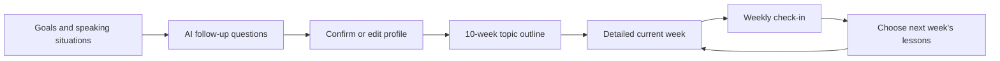

# Onboarding and adaptive roadmap plan

Status: owner likes the adaptive direction discussed on 2026-11-23. This is a product plan for the AI prototype, not a claim that the team has built or validated it. Frontend and wider project technology decisions remain with the team.

## Onboarding

1. Collect the general app information, then ask the five confirmed speaking questions below.
2. The OpenAI API model asks two personalized follow-up questions based on the answers. Use selectable answers and an Other option; avoid repeating answered questions and focus on information that changes the first week's activities. The custom audio/video analysis model does not generate these questions.
3. Show a concise profile summary and allow the user to correct it before generating the roadmap.
4. The owner subsequently proposed two speaking prompts with audio or audio plus video, followed by an optional third prompt. The recording and analysis design is still to be discussed; the current backend prototype scope and API availability need review before implementation.

### Confirmed onboarding questions

The owner confirmed this question set on 2026-11-23. These general app questions come before the speaking questions:

- What is your name?
- How old are you? Collect age, not date of birth. Send only a coarse age band to the model when needed for age-appropriate wording; do not send the name as part of the roadmap model input.
- What is your preferred language? English is the only practice language supported in the current prototype. Do not imply that another selected language is supported yet.

Then ask, in this order, with multiple-choice or multi-select options and an **Other** option:

1. **Why do you want to improve your speaking?** Select up to two: Do better at school; grow at work; prepare for a job or college; feel more comfortable in everyday life; connect with people; work toward a personal goal; Other.
2. **What would you most like to be able to do?** Select up to two: Explain ideas clearly; organize my thoughts; speak at a comfortable pace; be heard clearly; keep people interested; respond without much preparation; use body language effectively; Other.
3. **What usually gets in the way when you try to do that?** Select up to two: I lose my train of thought; rush or speak too slowly; struggle to find words; speak too quietly; feel nervous; have trouble holding attention; feel unsure what to do with my body; Other.
4. **Think of a recent time that happened. What were you doing?** Choose: Giving a presentation; answering a question; talking one-on-one; speaking in a group; interviewing; Other. Optional short answer: **What happened?**
5. **Which one matters most to you right now?** Show the user's selected outcomes and challenges and let them choose one.

Use short free text for Other where appropriate. The owner confirmed the five questions above, not a separate question about preferred example topics. The lesson pattern is consistent: learn briefly, check understanding, apply the skill, continue, and occasionally complete a section assessment. Do not ask a practice-preference question unless the product can actually use its answer. Do not ask for diagnoses or medical history.

## Roadmap

- Show a personalized ten-week outline of broad topics and the user's goal. Plan for ten minutes per day.
- Generate seven concrete activities for the current week from a small, researched and reviewed activity catalog. Explain how the week's focus connects to the user's answers. Show completed weeks and their activities as history.
- Use the general skill progression as a flexible guide. The owner's latest direction emphasizes the user's chosen goal for roughly two to five weeks, depending on the goal, then branches into broader speaking skills. The exact allocation and transition remain to be designed.
- At the end of a week, propose a short check-in and choose the next week's detailed activities. Bring back a skill that needs more work while introducing new material. Do not prevent the user from moving forward. If a check-in is skipped, continue with the planned direction.
- Self-reported difficulty and activity completion are possible early inputs for future adaptation. Do not label them as measured mastery. Real speech or camera analysis may be integrated after the team validates the relevant APIs.
- Showing detailed next-week activities ahead of the check-in remains an open preference. The owner explicitly liked the adaptive approach but has not resolved whether their earlier reference meant the previous or next week.

## Prototype boundary and handoff

The current agreed backend prototype covers initial questions, bounded AI follow-ups, profile confirmation, and roadmap generation. Use a stateless Python/FastAPI service with server-side OpenAI calls and a reviewed seed catalog. The React Native frontend is handled by teammates. Weekly check-in execution, storage, and ongoing adaptation are later work unless separately approved; the initial roadmap should describe the intended check-in without claiming it has happened.

This plan supersedes the earlier master prompt's requirement to generate 70 detailed daily activities during onboarding. Update any future implementation handoff to return a broad ten-week outline and seven detailed current-week activities instead. Preserve the earlier master prompt as historical context until it is revised to match this plan.

## Example

For a user who rushes presentation openings and loses their place between topics, week one might practice a short opening with a deliberate pause. The ten-week outline can then introduce transitions, organization and audience engagement. A later check-in could add another opening drill alongside transition practice if the user reports it would help.

## Evaluation

Measure onboarding completion and time, whether users understand why the first activity was selected, first-activity starts and returns for the next week. Compare distinct profiles to check that activity selection changes, not just the wording. The benefits of weekly check-ins and retention are hypotheses to test, not established results.

## Design references

- Duolingo describes a visible path with practice and review: https://blog.duolingo.com/new-duolingo-home-screen-design/
- Duolingo describes adapting exercise difficulty using learner and content estimates: https://blog.duolingo.com/learning-how-to-help-you-learn-introducing-birdbrain/
- ELSA describes learning paths using level, goals and progress: https://elsaspeak.com/en/
- Speak describes an expert-crafted curriculum personalized to goals and learning history: https://www.speak.com/

These sources inform the direction. They do not demonstrate that this exact onboarding or weekly cadence improves Speakly retention.
